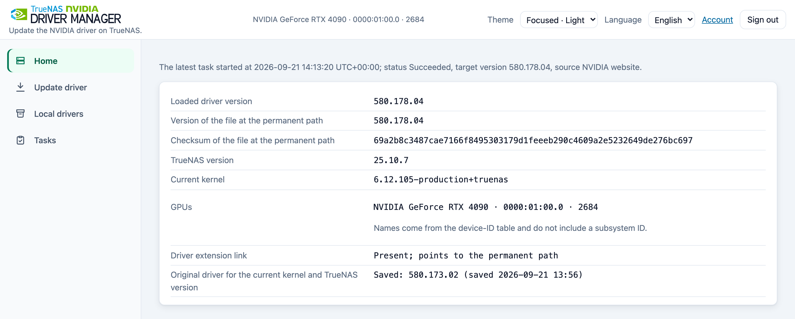
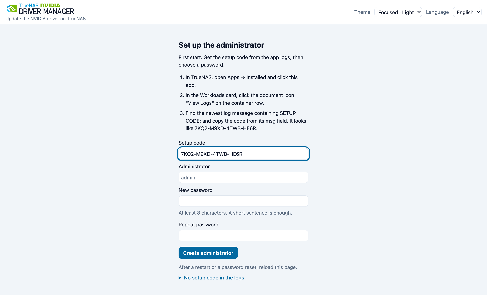
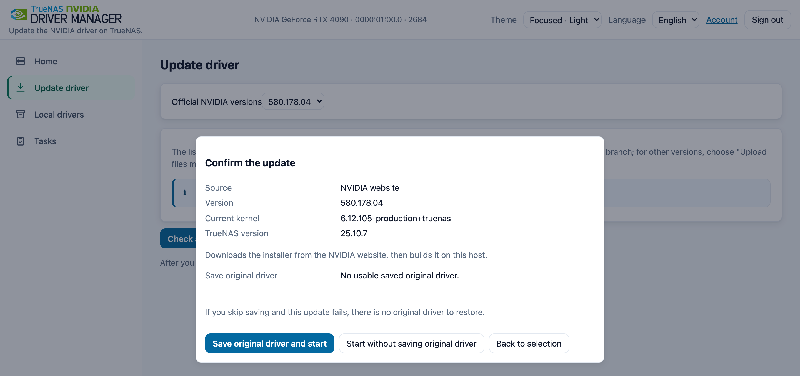

<p>
  <picture>
    <source media="(prefers-color-scheme: dark)" srcset="docs/images/lockup-dark.svg">
    
  </picture>
</p>

**English** | [简体中文](README.zh-CN.md)

Update the NVIDIA driver on your TrueNAS machine from a web page. You pick a version, confirm it, and the page shows which driver is really in use.

Jump to: [Install](#install) · [Update your driver](#update-your-driver) · [If something goes wrong](#if-something-goes-wrong) · [Stay safe](#stay-safe) · [More documentation](#more-documentation)



## What it does

- Shows the official NVIDIA driver versions that fit your card. You can also upload driver files yourself, or go back to a driver the manager saved earlier.
- Prepares the driver for your TrueNAS version and swaps it in.
- Checks afterwards which driver version is loaded.
- Saves the original driver, so you can go back to it.

## What it does not do

- It never updates by itself. You confirm every change.
- It does not stop your apps; you stop the ones that use the GPU.
- It cannot promise recovery. If the new driver fails its check, the manager tries to bring the original back, and that can fail too (see the warning under [Update your driver](#update-your-driver)).

## Does it fit your machine?

- TrueNAS 25.10.7 (Community Edition) or TrueNAS 27.0.0-RC.1, on a 64-bit Intel or AMD computer. Other versions and ARM computers are untested.
- An NVIDIA graphics card (GPU). Older cards have limits, see [choosing a driver for your GPU](docs/operations.en.md#choosing-a-driver-for-your-gpu).
- Internet access, to download the driver (from nvidia.com) and the build tools (from Docker Hub and Debian). Without internet you can switch to a driver saved earlier. Uploaded files also work once you have prepared the build files described in the [deployment guide](docs/deploy.en.md).

## Install

1. Switch on the NVIDIA driver in TrueNAS. Home shows a notice if this switch is still off.
   - 25.10.7: Apps → Installed → Configuration → Settings, tick Install NVIDIA Drivers, click Save.
   - 27.0.0-RC.1: System → Advanced Settings, click Configure on the NVIDIA Drivers card, tick Enable NVIDIA GPU Support, click Save.
2. Create a dataset for the manager. A dataset is a folder that TrueNAS makes inside a storage pool. This is the dataset you back up later.
   1. Open Datasets, select your pool and click Add Dataset.
   2. Name it, for example `nvm`.
   3. In Advanced Options, allow running programs (`exec=on`).
   4. Save.

   The [deployment guide](docs/deploy.en.md) lists every requirement.
3. Install the app from YAML (a short text that tells TrueNAS how to run it).
   1. In Apps → Discover Apps, click ⋮ next to Custom App and choose Install via YAML.
   2. Give the app any name.
   3. Paste the text below.
   4. Replace `<pool>` and `<dataset>` with your pool and dataset names. Keep `:/var/lib/nvm`.
   5. Save.

```yaml
services:
  nvidia-driver-manager:
    image: ghcr.io/sky-zhang01/truenas-nvidia-driver-manager:latest
    restart: unless-stopped
    privileged: true
    pid: host
    runtime: runc
    volumes:
      - /mnt/<pool>/<dataset>:/var/lib/nvm
    ports:
      - "8199:8199"
```

> [!WARNING]
> `privileged: true` and `pid: host` give the app control of the machine itself. It needs this to change the driver. Read [Stay safe](#stay-safe) before you install.

Need a different port, an address of its own for the app, or an offline install? See the [deployment guide](docs/deploy.en.md).

4. Find the setup code in the app's log.
   1. Wait until the app shows Running.
   2. Open Apps → Installed → your app → Workloads and click the document icon (View Logs) on the container's row.
   3. Look at the bottom for the newest line that contains `SETUP CODE:`.
   4. Copy the four groups of characters after it, without the quotes or the final period. The line looks like this, with a different code:

      ```json
      { "event": "setup_code_issued", "msg": "SETUP CODE: 7KQ2-M9XD-4TWB-HE6R. ..." }
      ```

   If the log is empty, wait a minute and open it again.

5. Create your administrator.
   1. Open `http://<nas-ip>:8199/` in a browser. `<nas-ip>` is the address you use to open TrueNAS. If you gave the app an address of its own, use that one instead (see the [deployment guide](docs/deploy.en.md)).
   2. Enter the setup code and keep the user name `admin`.
   3. Choose a password of at least 8 characters and type it twice.
   4. Click Create administrator. You are signed in.



*Example only. Your code is in the app logs.*

The code works once and stays valid for 24 hours. Restarting the app before setup makes a new one, so use the latest. Later you sign in with `admin` and your password.

## Update your driver

> [!WARNING]
> Changing the driver interrupts every app that uses the GPU, and recovery can fail. Pick a quiet time. Save the original driver on your first update. Keep direct access to the machine (System → Shell in TrueNAS, or a keyboard and screen) in case the GPU does not come back.

1. Open Update driver and tick your GPU.
2. Choose an official NVIDIA version.
3. Click "Check and continue".
4. Stop the apps marked "Using the GPU now" (in TrueNAS: Apps → Installed → the app → Stop). The check then continues by itself. If the wait has already ended, click "Check again" after stopping the apps.
5. In the confirmation window, click "Save original driver and start". If the original is already saved, click "Start update".
6. Wait for the task to finish. It keeps running if you close the browser.
7. Check that the task shows Succeeded and that Home shows the new version.
8. Restart the GPU apps that were running before the change. This includes apps Home lists under "Driver version changed" and apps that report "Driver/library version mismatch".



The original driver is the driver file in TrueNAS's fixed driver location when you first choose to save it. One copy is kept for each combination of kernel (the core of the system) and TrueNAS version. Save it before your first update, so the copy is the driver you had before any change. It may not be the driver TrueNAS shipped with: the manager does not check where it came from. To go back to it later, open Local drivers, choose the row whose source is Original and click Restore this version. This works without internet.

Optional: a full-speed unlock for GeForce RTX cards. It is off by default; see the [operations guide](docs/operations.en.md#full-speed-gpu-unlock-gpu-unlock).

Screenshots of every step, the upload rules and other details are in the [operations guide](docs/operations.en.md#updating-a-driver-step-by-step).

## If something goes wrong

Open Home first. It shows which driver is loaded.

- **The update failed at the start.** If the task page says nothing was changed, read its message, fix the cause and update again. Then check that your GPU apps still start, and restart them if they do not.
- **"Original driver restored".** The new driver failed its check and the original is back. The update you asked for did not succeed. If no original was saved, the manager can only report the failure, so save it before updating.
- **"Interrupted" (power loss or restart).** Home shows the loaded driver version and the step that stopped. Check the version, then update again. If your apps still cannot use the GPU, restore the Original driver in Local drivers, then restart the machine in a quiet time. A restart does not always fix it.
- **The version list is empty or a download fails.** The machine must reach the sites it downloads from (nvidia.com, Docker Hub and Debian). Check its network settings and firewall, then read the task log.
- **The setup code is rejected, or you forgot the password.** Reload the page, copy the newest code from the app logs, or reset the account as described in the [operations guide](docs/operations.en.md#forgot-the-password-resetting-the-administrator-account).

Logs are on every task page. If you used another NVIDIA driver tool before, it may reinstall its own driver at every boot and undo this update; see the [operations guide](docs/operations.en.md#troubleshooting-and-reporting-a-problem).

## Stay safe

- Back up the dataset you created in step 2 of Install. It holds your account, task history and saved drivers, including the original.
- The manager has the same power over the machine as the TrueNAS administrator. Anyone who can sign in controls the driver and the machine.
- The page uses plain HTTP, so traffic is not encrypted, and by default your whole network can reach it. Restrict it to a trusted management network. Do not forward its port to the internet.
- Finish setup soon after the first start. Until then, anyone who can read the app logs can use the setup code.
- Choose a strong password and upload only files you trust. An uploaded installer runs on your machine and becomes part of the system.

## More documentation

- [Deployment guide](docs/deploy.en.md): networks, upgrading and pinning the app version, offline install and builds.
- [Operations guide](docs/operations.en.md): step-by-step updates, choosing a driver, uploads, local drivers, going back to the original, SSH key sign-in, password reset, backup, logs.
- [Security guide](docs/security.en.md): how the manager works, the access it needs and its known limits.
- [Agent guide](docs/agent.en.md): lets an AI agent such as Claude Code or Codex do an update. A signed-in agent has full administrator power, and the manager cannot check that it asked you first.
- [Security reporting](SECURITY.md), [contributing](CONTRIBUTING.md), [changelog](CHANGELOG.md).
- Found a problem? Open an issue with the details listed in the [operations guide](docs/operations.en.md#troubleshooting-and-reporting-a-problem).

## License and credits

The source code is MIT-licensed, except the gpu-unlock kernel module in `third_party/gpu-unlock/`, which is GPL-2.0-only. See [`LICENSE`](LICENSE).

The manager's image does not contain the NVIDIA driver or the unlock firmware. For an official update your machine downloads the driver from NVIDIA, and uploaded installers come from you. NVIDIA driver software follows NVIDIA's license terms.

Credits for the Debian patches, the build script and the unlock module are in [`THIRD_PARTY_NOTICES.md`](THIRD_PARTY_NOTICES.md).

This project is not affiliated with or endorsed by iXsystems or NVIDIA. TrueNAS is a trademark of iXsystems, Inc. NVIDIA is a trademark of NVIDIA Corporation. The logo and brand material, including the wordmarks drawn into the artwork, are not MIT-licensed. Their rights stay with their owners.
