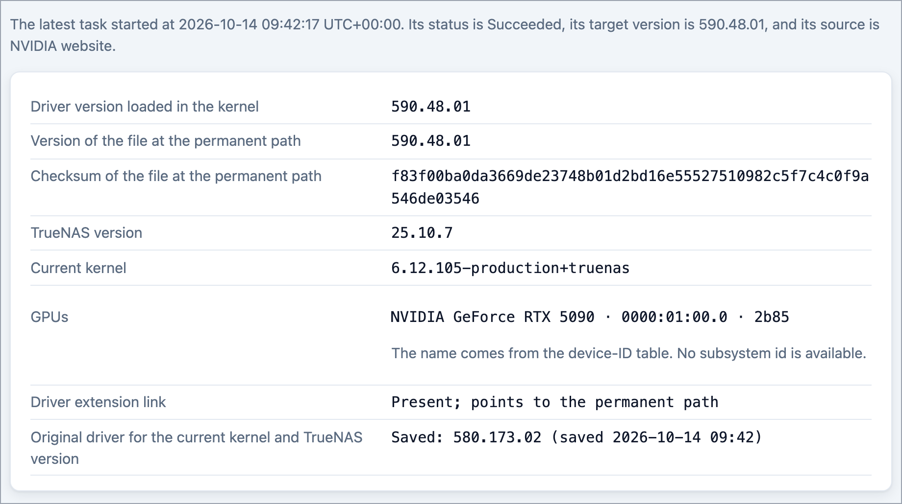
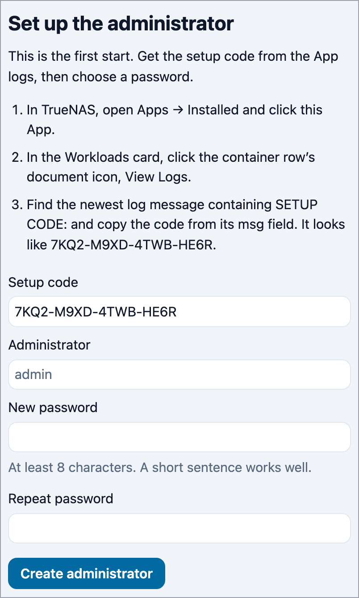
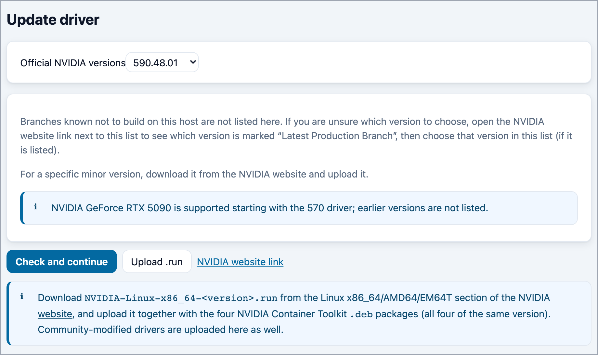
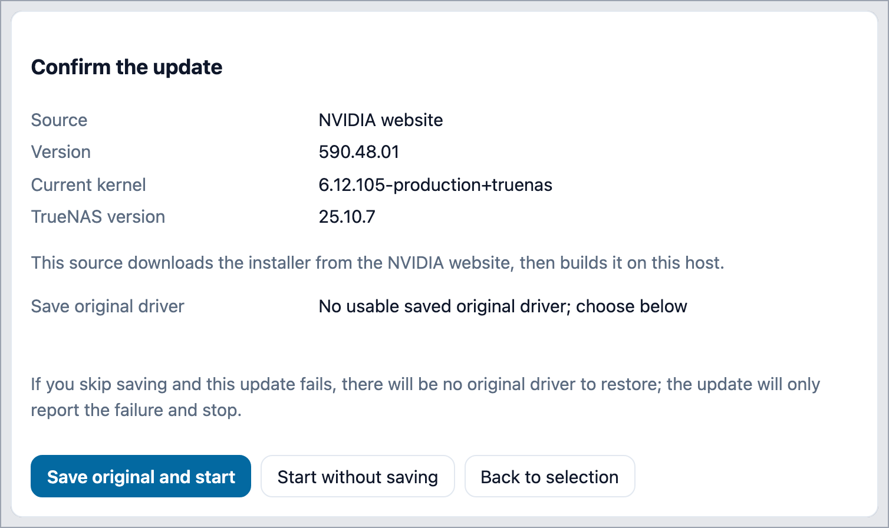
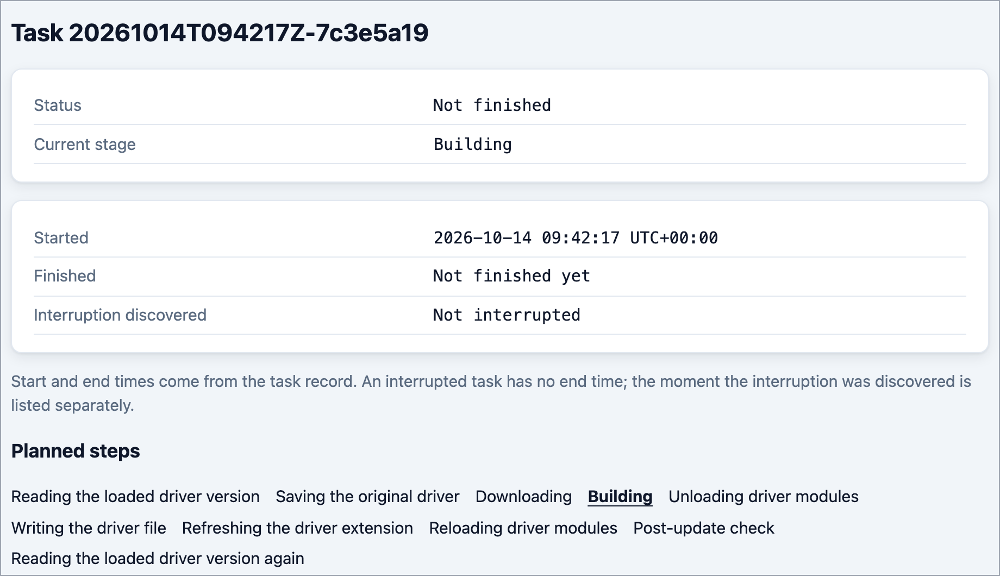
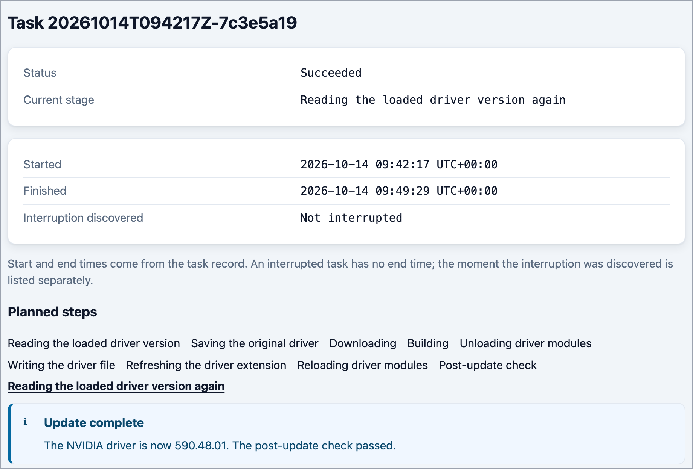
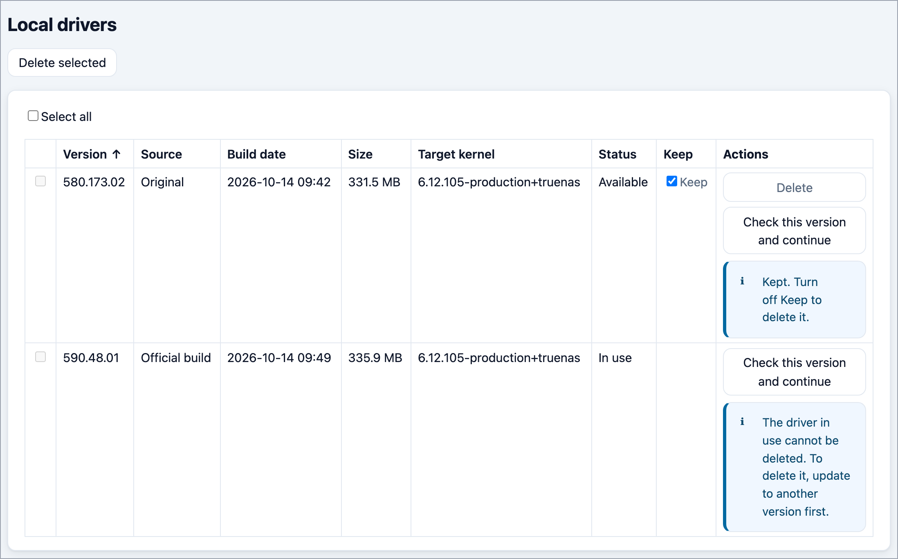

<p>
  <picture>
    <source media="(prefers-color-scheme: dark)" srcset="docs/images/lockup-dark.svg">
    
  </picture>
</p>

Update the NVIDIA driver on your TrueNAS from a web page. Pick a version, confirm, and let the manager install and check it.

**Jump to:** [Before you start](#before-you-start) · [Install](#install-in-five-steps) · [Update your driver](#update-your-driver) · [Restart GPU Apps](#6-restart-your-gpu-apps) · [If something goes wrong](#if-something-goes-wrong) · [Stay safe](#stay-safe) · [FAQ](#faq) · [简体中文](README.zh-CN.md)



*Home shows the loaded driver, your GPU and whether the original driver is saved.*

## What it does for you

You bought a new NVIDIA GPU, or a game, AI tool or media app needs a newer driver than the one TrueNAS SCALE ships. TrueNAS itself has no button for changing the driver.

This tool adds that button. It runs as a normal TrueNAS App, and you use it in your browser. This page calls it "the manager".

1. It shows the driver versions you can choose from.
2. It prepares the driver for your NAS and installs it.
3. It checks that the new driver is really loaded.
4. It keeps the driver that came with TrueNAS (called the "original driver"), so you can go back to it.

Every change needs your confirmation, and nothing updates by itself. If the check after an update fails and an original driver is saved, the manager tries to put the original back. That recovery can fail too, so always check the result on the Home page.

## Before you start

- TrueNAS SCALE **25.10.7** on a common 64-bit x86 PC (amd64). This is the only setup that has been tested.
- An NVIDIA GPU in the NAS.
- The NVIDIA driver switched on in TrueNAS: on **Apps → Installed**, click **Configuration → Settings** and tick **Install NVIDIA Drivers**. The manager replaces that driver, so it has to exist first. If it is missing, the manager's Home page tells you.
- A dataset (a storage folder in your pool) just for the manager. In TrueNAS, open **Datasets**, select your pool, click **Add Dataset**, and name it, for example `nvm`. Its folder is then `/mnt/<pool>/nvm`, where `<pool>` is the name of your pool. The dataset must allow running programs (the ZFS setting `exec=on`). Check this under **Advanced Options** of the new dataset. The [deployment guide](docs/deploy.en.md) lists the exact requirements.
- Internet access on the NAS, to reach NVIDIA's download site, Docker Hub and Debian's package archive. For offline use, see the [deployment guide](docs/deploy.en.md).
- An idle period when nobody uses the NAS, and a way to reach the NAS directly: the TrueNAS Shell, or a keyboard and screen on the NAS.

> [!WARNING]
> Changing the driver interrupts every App that uses the GPU. Pick an idle period. Save the original driver before your first update, and keep direct access to the NAS ready in case the GPU does not come back.
>
> The YAML file you install from asks for extended rights (`privileged: true` and `pid: host`). The manager needs them to change the driver of the NAS itself. That is also why you should read [Stay safe](#stay-safe).

## Install in five steps

### 1. Open the YAML installer

In TrueNAS, open **Apps → Discover Apps**. Next to "Custom App", click **⋮** ("More Options") and choose **Install via YAML**. Give the App any name you like.

### 2. Paste the YAML and set the data folder

Open [`deploy/compose.yaml`](deploy/compose.yaml) on GitHub, click the copy button, and paste the whole text into the YAML box. Replace `/mnt/<pool>/<dataset>` with the dataset folder you prepared (your data folder): `<pool>` is your pool's name and `<dataset>` is the dataset name, such as `nvm`. Keep `:/var/lib/nvm` after it.

### 3. Save and start the App

Leave the other lines as they are, and save. The file publishes the manager on port 8199 of your NAS (the "bridge" setting); the [deployment guide](docs/deploy.en.md) covers other network setups. TrueNAS removes the comments from the YAML when it saves, which is normal.

### 4. Copy the setup code from the logs

1. Wait until the App shows as running, then open **Apps → Installed → your App → Workloads** and click the document icon (**View Logs**) on the container's row. If the log is empty, wait a minute and open it again.
2. Find the latest `setup_code_issued` event: **the newest entry is at the bottom**. Each log entry is JSON, with `SETUP CODE:` inside its `msg` text.
3. Copy only the four groups after `SETUP CODE:`, without quotes or the full stop. Your code differs from the example below.

Other fields and the rest of the message are left out ("..."); the real log entry is a single line.

```json
{
  "event": "setup_code_issued",
  "msg": "SETUP CODE: 7KQ2-M9XD-4TWB-HE6R. ..."
}
```

### 5. Create your administrator account

For `<nas-ip>`, use the address you use to open TrueNAS; on a home network it usually starts with `192.168.`. If you gave the App its own address (macvlan), use that instead, as explained in the [deployment guide](docs/deploy.en.md).

1. Open `http://<nas-ip>:8199/` in your browser.
2. Enter the setup code and keep the prefilled user name `admin`.
3. Choose a password of at least 8 characters and type it twice.
4. Click **Create administrator**. You are signed in and can start updating.

If the code is rejected, see the FAQ entry [The setup code is rejected, expired or missing.](#faq)



*Example only. Your code is in the App logs; enter it and choose the administrator password.*

The setup code works once and stays valid for 24 hours. Restarting the App before setup makes a new code, so always take the latest one. The setup code is only for the first start. Next time, open the same address and sign in as `admin` with your password. Restarting the App later needs no code.

## Update your driver

### 1. Choose a driver version

1. Open **Update driver** in the menu on the left (at the bottom on a narrow screen). If you have more than one NVIDIA GPU, tick the GPUs that will use the driver.
2. Click the "Official NVIDIA versions" dropdown to choose a version.
3. If unsure, open the "NVIDIA website link", find "Latest Production Branch", and choose that version here if listed.
4. Click **Check and continue**.

The **Upload .run** button is for an installer you downloaded yourself; see [Driver sources](#driver-sources) below.



*Choose an official NVIDIA version, then check it before continuing.*

### 2. Read the check

Before asking for confirmation, the manager checks your GPU, kernel and Apps. If it lists Apps still using the GPU, stop those Apps yourself and try again. The manager never stops your Apps for you.

### 3. Save the original and confirm

The confirmation window shows the source, version and your system. If it asks whether to save the original driver, choose **Save original and start**; this is the safest choice. If an original is already saved, the button reads **Start update**.



*Check the version and system, and save the original driver before starting.*

### 4. Wait for the task

The task page shows the current stage; the live log is further down the page. Only one update runs at a time, and it keeps running if you close the browser. Downloading and building share a default limit of 30 minutes; if it expires before the driver file is replaced, the update stops and the file stays unchanged.



*The task page highlights the current stage.*

### 5. Check the result

The task ends as **Succeeded**, and the post-update check shows your new version. Home shows the same version.



*Confirm both the successful task status and the version in the post-update check.*

### 6. Restart your GPU Apps

After an update, restart the Apps that use the GPU. If the Home page lists Apps under "Driver version changed", restart those. If an App fails to start with a message such as "Driver/library version mismatch", restart that App too.

<details>
<summary>Local drivers: saved versions and available actions</summary>

The **Local drivers** page lists the drivers the manager has built or saved. You can switch between them without downloading again.



*Local drivers marks the version in use and keeps saved versions available.*
</details>

### Driver sources

You can choose a driver from three places:

- **The official NVIDIA list.** The NAS downloads the driver from NVIDIA. This is the way described above, and the right one for most people.
- **A file you upload.** For this, download NVIDIA's Linux installer (a `.run` file) yourself and add the four helper packages the Update driver page names.
- **A driver you saved before.** Switching to it needs no download.

## If something goes wrong

- **The update fails before the driver file is replaced.** The driver file is unchanged. Read the message on the task page, fix the cause, and update again. The driver modules may already have been unloaded, so check that your GPU Apps still start, and restart them if they do not. The Home page shows which driver is loaded.
- **The new driver fails its check, and an original is saved.** The manager tries to put the original driver back. If the task reads "Original driver restored", the recovery worked. The update itself did not.
- **No original is saved.** The manager can only report the failure. This is why we suggest saving the original first.
- **You want the original driver back.** Open **Local drivers**, choose the row whose source is **Original**, and click **Check this version and continue**. This needs no internet.
- **The setup code is rejected, expired or missing.** See the FAQ entry [The setup code is rejected, expired or missing.](#faq)
- **A task shows "Interrupted"** (power loss, host restart). Open Home. It shows the loaded driver version and which step stopped. Check the version, then update again. If your Apps still cannot use the GPU, switch to the **Original** entry in **Local drivers**. Then, in an idle period, restart the NAS so TrueNAS loads the current driver again. A restart is not a guarantee of recovery.

If recovery fails, you need direct access to the NAS. Logs are on each task page. The [operations guide](docs/operations.en.md) lists every case in detail.

## Stay safe

- **The manager can change your NAS.** It has the same power as the TrueNAS administrator. Anyone who can sign in to it controls the driver and the host.
- **Keep it on your home network.** The page uses plain HTTP and is reachable from your whole network by default. Do not forward its port to the internet.
- **Finish setup soon after the first start.** Until then, anyone who can read the App logs can use the setup code.
- **Choose a strong password** and upload only files you trust. An uploaded installer runs on your NAS and becomes part of the system.
- **Save the original driver and back up the data folder.** The data folder holds your account, task history and saved drivers, including the original.

Everything else, such as resource use while building, is in the [security guide](docs/security.en.md).

## FAQ

<details>
<summary>Does it update by itself?</summary>

No. Every change needs your click on the confirmation window.
</details>

<details>
<summary>Will it work on other TrueNAS versions or on ARM?</summary>

Only TrueNAS SCALE 25.10.7 on amd64 is tested. Other versions and chips are untested. A version in the list does not promise it works with your GPU or Apps. Read the checks and warnings before you confirm.
</details>

<details>
<summary>The version list is empty, or the download fails.</summary>

The NAS needs to reach NVIDIA's download site, Docker Hub and Debian's package archive. Check your firewall and DNS, then look at the task log. The versions shown also depend on the GPU you ticked. An old GPU only sees the versions it can use.
</details>

<details>
<summary>An update stopped halfway.</summary>

Open Home and the task page. They show which step stopped and the loaded driver version. The [operations guide](docs/operations.en.md) explains each stage.
</details>

<details>
<summary>The setup code is rejected, expired or missing.</summary>

1. Reload the manager page. An expired code is replaced by a new one in the logs.
2. Open the App logs again and copy the code from the newest line that contains `SETUP CODE:`. The newest line is at the bottom. Copy only the four groups, without quotes.
3. If there is no such line, restart the App from **Apps → Installed**, wait a minute, and read the logs again.
4. If the page says to try again later, wait for the time it shows. Wrong codes and wrong passwords share one limit.
</details>

<details>
<summary>I forgot the password.</summary>

1. Open the Shell of the NAS itself in TrueNAS (**System → Shell**). The manager's own Shell button shows nothing, so do not use it.
2. Delete the account file `web-credentials.json` in the data folder. Replace `<data folder>` with the path you typed in the YAML, the part before `:/var/lib/nvm`. This removes the account and the saved SSH keys, and signs out every device. Drivers and tasks stay:

   ```sh
   rm '<data folder>/manager/secrets/web-credentials.json'
   ```

3. Reload the page. It now shows the setup page again, and the App writes a new code to its logs.
4. In TrueNAS, open **Apps → Installed**, click your App, and on the **Workloads** card click the document icon (**View Logs**) on the container's row. Copy the code from the latest message that contains `SETUP CODE:`. If no new message appears, reload the page once more, then restart the App.
5. Enter the code and choose a new password. You do not need to restart the App. Register your SSH keys again if you use them.

The [operations guide](docs/operations.en.md) has the details.
</details>

<details>
<summary>The App's Shell button in TrueNAS shows nothing.</summary>

The manager's image has no shell inside. That is expected. Use the task page for diagnostics.
</details>

<details>
<summary>How do I update or remove the manager itself?</summary>

Back up the data folder first. With the `latest` tag, open **Apps → Installed**, click your App, and on the **Application Info** card choose **⋮ → Update** when a new image is offered. To move to a fixed version instead, click **Edit**, change the image tag to the version number, and save. Changing the App does not change the NVIDIA driver on the NAS. If you want the original driver back, do that in **Local drivers** first. The [deployment guide](docs/deploy.en.md) has the details. A step-by-step guide for removing the manager is not written yet.

The image tag in the YAML is `latest`. To stay on a fixed version, change it to `0.2.1`: `ghcr.io/sky-zhang01/truenas-nvidia-driver-manager:0.2.1`.
</details>

## For advanced users

- [Deployment guide](docs/deploy.en.md): networks (bridge, macvlan, ipvlan), App upgrade and revert, offline install and offline builds, online sources.
- [Operations guide](docs/operations.en.md): return to the original driver, troubleshooting, SSH key sign-in, password reset, backup, interrupted tasks, logs.
- [Security guide](docs/security.en.md): how the manager works, what access it needs, session handling, TLS and known limits.
- [Agent guide](docs/agent.en.md) and the [agent skill](skills/nvidia-driver-replacement/SKILL.md): let an AI agent such as Claude Code or Codex do an update. The agent is instructed to ask you before every replacement, but the manager cannot verify that it did. A signed-in agent has full administrator power.
- [Security reporting](SECURITY.md), [contributing and local development](CONTRIBUTING.md), [changelog](CHANGELOG.md).

<details>
<summary>Optional: verify that an image comes from this repository</summary>

```bash
gh attestation verify oci://ghcr.io/sky-zhang01/truenas-nvidia-driver-manager:0.2.1 --repo sky-zhang01/truenas-nvidia-driver-manager
```
</details>

## Help

Open an issue and include: the manager version, your TrueNAS and kernel versions, the GPU model, the driver source and target version, the task status and the task log. Remove addresses, paths, passwords and keys from the log first. Report security problems privately, as described in [SECURITY.md](SECURITY.md).

## License and trademarks

The source code is MIT-licensed. See [`LICENSE`](LICENSE) and [`THIRD_PARTY_NOTICES.md`](THIRD_PARTY_NOTICES.md).

This project is **not affiliated with or endorsed by iXsystems or NVIDIA**. TrueNAS is a trademark of iXsystems, Inc. NVIDIA is a trademark of NVIDIA Corporation. The logo and brand material, including the embedded wordmarks, are not MIT-licensed. Their rights stay with their owners.

The manager's image does not contain the NVIDIA driver. For an official update, your NAS downloads it from NVIDIA. Uploaded installers come from you. NVIDIA driver software follows NVIDIA's license terms, apart from this project's MIT license.
