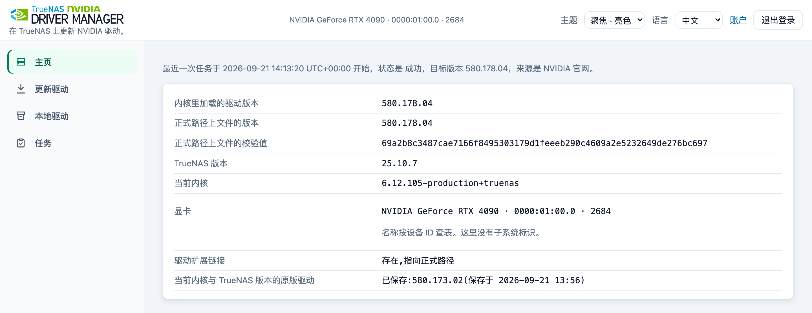
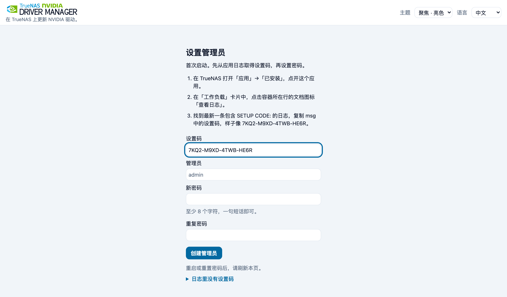
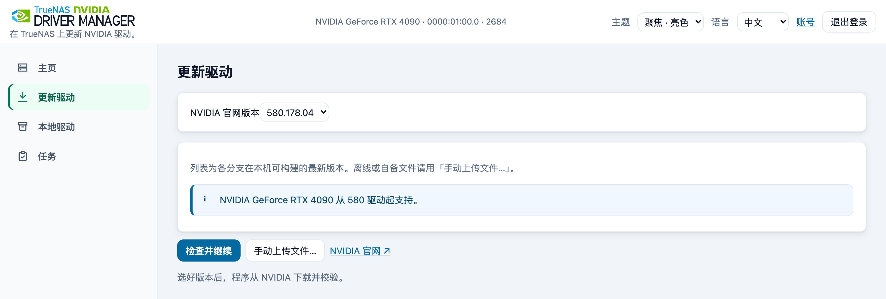
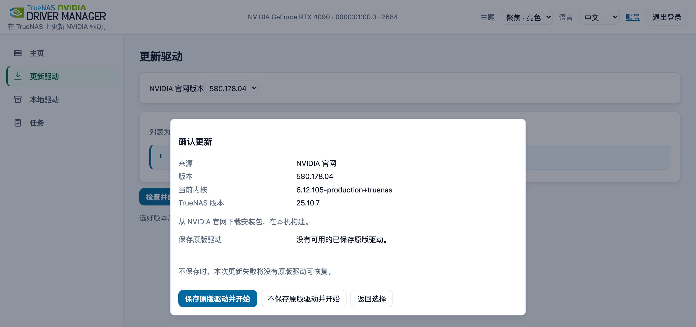
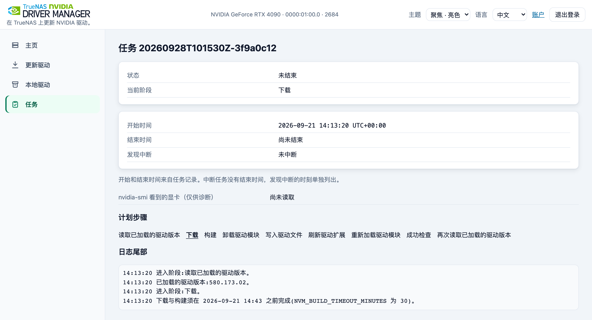
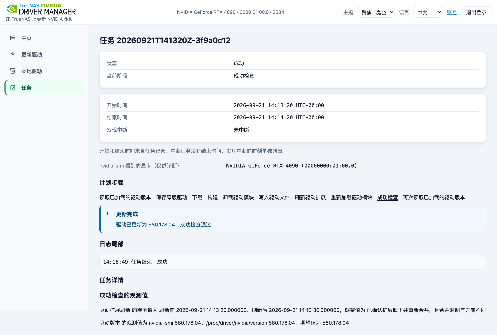
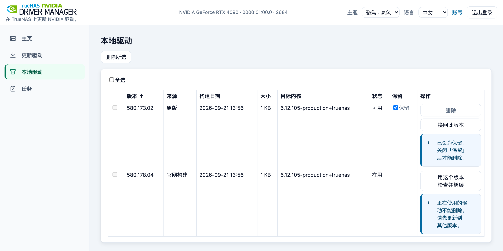

<p>
  <picture>
    <source media="(prefers-color-scheme: dark)" srcset="docs/images/lockup-dark.svg">
    
  </picture>
</p>

在浏览器中选择 NVIDIA 驱动、确认计划，再核对 TrueNAS 加载的版本。

快速跳转：[安装](#安装) · [更新驱动](#更新你的驱动) · [排障](#排障) · [安全使用](#安全使用) · [常见问题](#常见问题) · [English](README.md)



可选择 NVIDIA 官网版本、上传文件或本地驱动。每次更新须确认，并检查加载的版本。首次更新前建议保存「原版驱动」，供成功检查失败时尝试恢复。「原版」是为当前内核与 TrueNAS 版本第一次选择保存时，正式路径上的那份驱动文件；程序不判断它是否由 TrueNAS 提供。恢复也可能失败。

支持 TrueNAS SCALE 25.10.7 和 TrueNAS 27.0.0-RC.1（amd64）。

## 安装

1. 准备 TrueNAS。

- 主机须有 NVIDIA 显卡，并已启用 TrueNAS 的 NVIDIA 驱动。主页会提示驱动缺失。
  - 25.10.7：打开应用 → 已安装 → 配置 → 设置，勾选安装 NVIDIA 驱动程序，点保存。
  - 27.0.0-RC.1：打开系统 → 高级设置，在 NVIDIA Drivers 卡片点配置，勾选 Enable NVIDIA GPU Support，点保存。
- 为程序单独准备一个数据集（存储池里的一个存储目录）：打开数据集，选中存储池，点添加数据集，起名例如 `nvm`，目录为 `/mnt/<pool>/nvm`。在高级选项里确认允许运行程序（`exec=on`）。具体要求见[部署说明](docs/deploy.zh-CN.md)。
- 主机需要能联网，访问 NVIDIA 下载站、Docker Hub 和 Debian 软件包存档。离线使用请看[部署说明](docs/deploy.zh-CN.md)。

2. 通过 YAML 安装应用。打开应用 → 探索应用，点「自定义应用」旁边的 ⋮（「更多选项」），选择「通过YAML进行安装」，应用名称随便起。粘贴下面的内容，只把数据目录换成你准备的数据集目录（保留后面的 `:/var/lib/nvm`），然后保存：

```yaml
services:
  nvidia-driver-manager:
    image: ghcr.io/sky-zhang01/truenas-nvidia-driver-manager:latest
    restart: unless-stopped
    privileged: true
    pid: host
    runtime: runc
    volumes:
      - /mnt/<pool>/<dataset>:/var/lib/nvm
    ports:
      - "8199:8199"
```

> [!WARNING]
> `privileged: true` 和 `pid: host` 让应用能够控制主机；程序需要这些权限来更换主机驱动。安装前请先读[安全使用](#安全使用)。

程序会发布在主机的 8199 端口（bridge 方式）。macvlan、ipvlan、其他端口或离线使用方式见 [`deploy/compose.yaml`](deploy/compose.yaml) 和[部署说明](docs/deploy.zh-CN.md)。TrueNAS 保存时会去掉 YAML 注释，这是正常的。

3. 复制设置码。等应用显示为运行中，打开应用 → 已安装 → 你的应用 → 工作负载，在容器那一行点文档图标（查看日志）。最新的日志在最下面；日志为空时等一分钟再打开。找最新的 `setup_code_issued` 事件，每条日志都是 JSON，设置码在 `msg` 文字里。只复制 `SETUP CODE:` 后面的设置码（四段字符），不带引号和句号。你的设置码与示例不同（其余字段和消息后面的内容已省略，实际日志是单独一行）：

```json
{ "event": "setup_code_issued", "msg": "SETUP CODE: 7KQ2-M9XD-4TWB-HE6R. ..." }
```

4. 创建管理员。在浏览器打开 `http://<nas-ip>:8199/`（`<nas-ip>` 是平时打开 TrueNAS 用的地址；macvlan 则用应用自己的地址），输入设置码，保留用户名 `admin`，设定至少 8 个字符的密码并输入两次，点创建管理员后即登录。



*仅为示例。请到应用日志里取你的设置码，输入后设定管理员密码。*

设置码只能使用一次，24 小时内有效；设置完成前重启应用会生成新的设置码，所以用最新的一条。设置完成后用 `admin` 和你的密码登录，不再需要设置码。设置码被拒绝时，请看[常见问题](#常见问题)。

如果此前用过的工具会在开机时恢复它自己的驱动，重启后可能重新切换实际使用的驱动；本程序不会修改它的开机设置，是否停用由你决定。

## 更新你的驱动

> [!WARNING]
> 换驱动会中断所有使用显卡的应用。请选择空闲时段，第一次更新前先保存原版驱动，并准备好直接操作主机的方式（TrueNAS 的命令行，或接在主机上的键盘和显示器），以防显卡没有恢复。

1. 打开更新驱动，勾选显卡，选择 NVIDIA 官网版本，点检查并继续。
2. 等待时停止标为「正在使用显卡」的应用，检查会自动继续。程序不会替你停止应用。
3. 选择「保存原版驱动并开始」，确认更新。
4. 等待任务完成，关掉浏览器也不影响任务继续运行。
5. 确认任务成功，并核对任务页和主页上的新驱动版本。
6. 重启驱动变更前已启动的显卡应用，包括主页列出的应用和提示「Driver/library version mismatch」的应用。

每一步的截图和详细说明见下面的更新指南。

## 更新指南

<details>
<summary>1. 选择显卡和驱动</summary>

1. 在左侧菜单里打开更新驱动（窄屏时菜单在页面底部）。如果有不止一张 NVIDIA 显卡，勾选将使用这个驱动的显卡。
2. 点开「NVIDIA 官网版本」下拉框选择版本。列表列出每个分支在本机可构建的最新版本；其他版本选最后一项「其他版本…」并输入版本号。
3. 不确定时，点「NVIDIA 官网 ↗」找到标着「Latest Production Branch」的版本，如果下拉框里有，就选它。
4. 点检查并继续。

离线使用或自备文件（含社区修改版）时，点手动上传文件…，按 5 行清单准备，见[驱动来源](#驱动来源)。

Debian 社区兼容补丁只用于官方 470.256.02 的构建：手动上传的 470 安装包不会套用这些补丁；官方 470.256.02 的补丁构建需要联网下载补丁归档，不能像构建软件包那样事先放进 `manager/build-kit/`。



</details>

<details>
<summary>2. 检查显卡使用状态</summary>

检查期间显示正在使用或申请显卡的应用，名单自动刷新。请停止标为「正在使用显卡」的应用，检查会自动继续；等待约 30 秒后仍在使用时，结果窗口会注明采集时间，停止应用后点「重新检查」。

</details>

<details>
<summary>3. 确认更新</summary>

在确认窗口核对来源、版本和系统。提供保存选项时，选保存原版驱动并开始；已有原版时，点开始更新。



</details>

<details>
<summary>4. 跟进任务</summary>

任务页会显示当前阶段；实时日志在页面下方。同一时间只运行一个更新，关掉浏览器也不影响它继续运行。下载和构建默认共用 30 分钟的时限；如果在驱动文件被替换之前超时，更新会停止，驱动文件保持不变。



</details>

<details>
<summary>5. 核验结果</summary>

任务状态为成功，更新后的检查会显示你的新版本。主页显示的版本也一致。



</details>

<details>
<summary>6. 重启显卡应用</summary>

请重启驱动变更前已启动的显卡应用。主页「驱动版本已变更」列出的应用，以及提示「Driver/library version mismatch」的应用均需重启。

</details>

## 本地驱动

<details>
<summary>本地驱动：已保存的版本与可用操作</summary>

本地驱动页列出程序构建或保存过的驱动。在它们之间切换，不用重新下载。



</details>

## 驱动来源

<details>
<summary>三种驱动来源</summary>

驱动有三种来源：

- NVIDIA 官网版本。由主机从 NVIDIA 官网下载所选驱动。
- 你上传的文件。点手动上传文件…，按 5 行清单下载 1 个驱动安装包和 4 个 toolkit 包。每行都有在新标签页打开的下载链接。推荐 `NVIDIA-Linux-x86_64-<版本>-no-compat32.run`，它不含 TrueNAS 用不到的 32 位库；4 个 `.deb` 必须是同一版本的 amd64 包。toolkit 版本从 NVIDIA 官方索引读取，无法读取时使用 `1.20.1-1`。
- 之前保存过的驱动。切换过去不用再下载。

选好文件即上传：先传 `.deb`，再传较大的 `.run`。文件按内容归入清单（扩展名须为 `.run` 或 `.deb`），每行显示进度与错误；底部在文件未齐时显示已就绪数，齐全后显示完成摘要；上传中可确认取消，已收到的文件保留。5 个都就绪后点检查并继续。检查成功才打开确认窗口；点「返回选择」会回到上传清单，文件仍在。开始任务后，本次任务使用的上传文件不能再更换。指纹与校验值在确认窗口的文件详情里。程序检查文件内容与包版本，构建时运行安装包自带的完整性检查。程序不验证 NVIDIA 签名。构建失败时驱动文件不变。

</details>

## 排障

失败后请查看主页，确认当前加载的是哪个驱动。

<details>
<summary>排错与恢复</summary>

- 更新在替换驱动文件之前就失败了。驱动文件没有改动。看任务页上的提示，排除原因后重新更新。驱动模块可能已经被卸载，所以请确认使用显卡的应用还能启动，不能的话就重启它们。
- 新驱动没通过检查，且已保存原版驱动。程序会尝试恢复。任务显示「已恢复原版驱动」时，本次更新未成功。
- 没有保存原版。程序只能报告失败。更新前建议保存原版。
- 你想换回原版驱动。打开本地驱动，选来源为原版的那一行，点换回此版本。这一步不需要联网。
- 设置码被拒绝、已过期或找不到。请看常见问题里的[设置码恢复](#常见问题)
- 任务显示「已中断」（断电、主机重启）。打开主页，那里会显示已加载的驱动版本和停在哪一步。核对版本后再更新一次。如果应用仍然用不了显卡，先在本地驱动里切换到原版那一项，再在空闲时段重启主机，让 TrueNAS 重新加载当前驱动。重启仍可能无法恢复。

如果恢复失败，你需要能直接操作主机。每个任务页都有日志。所有情况的详细说明见[运维说明](docs/operations.zh-CN.md)。

</details>

## 安全使用

- 程序能改动你的主机。它拥有和 TrueNAS 管理员相当的权限。能登录它的人，就能控制驱动和主机。
- 限制为可信管理网络。页面是明文 HTTP，默认整个内网都能访问。不要把端口转发到互联网。
- 首次启动后尽快完成设置。在此之前，能读取应用日志的人都可以使用设置码。
- 用强密码，并且只上传你信任的文件。上传的安装包会在你的主机上运行，并成为系统的一部分。
- 先保存原版驱动，并备份数据目录。数据目录里有你的账号、任务记录和保存的驱动，包括原版驱动。

其余内容，比如构建时占用的资源，见[安全说明](docs/security.zh-CN.md)。

## 常见问题

<details>
<summary>会自动更新吗？</summary>

每次改动均须在确认窗口确认。

</details>

<details>
<summary>支持哪些系统？</summary>

支持并实测了 TrueNAS SCALE 25.10.7 与 TrueNAS 27.0.0-RC.1 / amd64，其他版本与架构都没测试。Maxwell、Pascal、Volta 显卡在 TrueNAS 27 上尚未实测。列表中的版本仍需结合显卡和应用核验。确认前请先看检查结果和警告。

</details>

<details>
<summary>哪些显卡用哪种驱动？</summary>

程序按你勾选的显卡决定内核模块类型。驱动版本为 555 及以上且勾选了显卡时，只要其中有只能用闭源模块的显卡（包括 Maxwell、Pascal、Volta），就编闭源模块，否则编开源模块。Maxwell、Pascal、Volta 最后支持的驱动分支是 580。

Kepler 显卡（包括部分 GTX 600/700 型号）请选择官方 470.256.02。TrueNAS 25.10（内核 6.12）与 TrueNAS 27（内核 6.18）都提供这个版本，程序会下载 Debian 的社区兼容补丁并套用。补丁应用与编译已在 TrueNAS 25.10.7 与 27.0.0-RC.1 的内核上实测；Kepler 上的加载、显示与 CUDA 尚未在真实硬件上验证。470 已停止维护，NVIDIA 不再发布安全修复，只建议给没有别的受支持驱动可用的显卡使用。

这套 Debian 补丁会让 470 在内核启用 IBT（间接分支跟踪）时拒绝加载，补丁说明写的是 Intel 第 11 代及更新的 CPU。可在 TrueNAS Shell 里运行 `grep '^flags[[:space:]]*:' /proc/cpuinfo | grep -c -w ibt` 查看：输出是报告了 `ibt` 的行数；0 只表示这次没有匹配到，不能据此确认 470 能加载；没有匹配时，命令的退出码为 1。

</details>

<details>
<summary>版本列表为空或下载失败时怎么办？</summary>

主机需要能访问 NVIDIA 下载站、Docker Hub 和 Debian 软件包存档。请检查防火墙和 DNS，再看任务日志。列表里的版本还取决于你勾选的显卡，较老的显卡只会看到它能用的版本。

</details>

<details>
<summary>更新到一半停止时怎么办？</summary>

打开主页和任务页，会看到停在哪一步以及已加载的驱动版本。每个阶段的含义见[运维说明](docs/operations.zh-CN.md)。

</details>

<details>
<summary>设置码被拒绝、已过期或找不到时怎么办？</summary>

1. 刷新程序页面。设置码过期后，日志里会写入新的设置码。
2. 再次打开应用日志，复制最新一条包含 `SETUP CODE:` 的日志里的设置码。最新的日志在最下面。只复制设置码（四段字符），不要带引号。
3. 如果没有这样的日志，在应用 → 已安装里重启应用，等一分钟，再看日志。
4. 页面提示稍后再试时，按提示的秒数等待。输错设置码和输错密码共用同一个次数限制。

</details>

<details>
<summary>怎样重置账号？</summary>

1. 在 TrueNAS 里打开主机的命令行（系统 → 命令行）。程序自己的命令行按钮点了没反应，不要用它。
2. 删除数据目录里的账号文件 `web-credentials.json`。命令里的 `<数据目录>` 换成你在 YAML 里填的路径，也就是 `:/var/lib/nvm` 前面那一段。这会删除账号和已保存的 SSH 密钥，并让所有设备退出登录，驱动和任务不受影响：

   ```sh
   rm '<数据目录>/manager/secrets/web-credentials.json'
   ```

3. 刷新页面，页面会重新显示设置页，应用会把新的设置码写进日志。
4. 在 TrueNAS 打开应用 → 已安装，点你的应用，在工作负载卡片里点容器那一行的文档图标（查看日志）。复制最新一条包含 `SETUP CODE:` 的日志里的设置码。如果没有出现新的日志，再刷新一次页面；还是没有就重启应用。
5. 输入设置码，设定新密码。不需要重启应用。如果你用 SSH 密钥，需要重新登记。

详细步骤见[运维说明](docs/operations.zh-CN.md)。

</details>

<details>
<summary>为什么 TrueNAS 中应用的命令行按钮没有反应？</summary>

程序的镜像里没有 shell，这是正常的。排查请看任务页。

</details>

<details>
<summary>怎样升级或删除程序？</summary>

先备份数据目录。使用 `latest` 标签时，打开应用 → 已安装，点你的应用，有新镜像时在应用信息卡片上选 ⋮ → 更新。想换到固定版本，就点编辑，把镜像标签改成版本号后保存。改动应用本身不会改变主机上的 NVIDIA 驱动。如果想换回原版驱动，请先在本地驱动里操作。详情见[部署说明](docs/deploy.zh-CN.md)。删除程序的分步说明还没有写。

YAML 里的镜像标签是 `latest`。想固定在某个版本，可以改成 `0.3.1`：`ghcr.io/sky-zhang01/truenas-nvidia-driver-manager:0.3.1`。

</details>

## 进阶用户

<details>
<summary>指南、智能体权限与镜像验证</summary>

- [部署说明](docs/deploy.zh-CN.md)：网络方式（bridge、macvlan、ipvlan）、应用升级与回退、离线安装与离线构建、联网下载来源。
- [运维说明](docs/operations.zh-CN.md)：换回原版驱动、排错、SSH 密钥登录、重置密码、备份、中断任务、日志。
- [安全说明](docs/security.zh-CN.md)：程序的工作方式、需要的权限、会话处理、TLS 与已知限制。
- [智能体说明](docs/agent.zh-CN.md)和[智能体技能](skills/nvidia-driver-replacement/SKILL.md)：让 Claude Code、Codex 这类 AI 智能体来做更新。智能体会被要求每次替换前先问你，但程序无法确认它是否真的问了。登录后的智能体拥有完整的管理员权限。
- [安全报告](SECURITY.zh-CN.md)、[贡献与本地开发](CONTRIBUTING.zh-CN.md)、[更新记录](CHANGELOG.zh-CN.md)。

<details>
<summary>可选：验证镜像确实来自本仓库</summary>

```bash
gh attestation verify oci://ghcr.io/sky-zhang01/truenas-nvidia-driver-manager:0.3.1 --repo sky-zhang01/truenas-nvidia-driver-manager
```

</details>

</details>

## 获取帮助

提交 issue 时请附上：程序版本、TrueNAS 和内核版本、显卡型号、驱动来源和目标版本、任务状态和任务日志。贴日志前先去掉其中的地址、路径、密码和密钥。安全问题请按 [SECURITY.zh-CN.md](SECURITY.zh-CN.md) 私下报告。

## 致谢

470 的兼容补丁来自 Debian 的 `nvidia-graphics-drivers-tesla-470` 打包（470.256.02-10），由 Debian 的 NVIDIA 维护者整理，主要作者为 Andreas Beckmann，另有数位贡献者。Debian 将这些补丁标为放弃版权的公有领域声明。程序在构建时从 snapshot.debian.org 下载并原样应用，本仓库不包含这些补丁。构建脚本的一部分取自 `biohazardious/truenas-nvidia-driver-updater`，见 [THIRD_PARTY_NOTICES.md](THIRD_PARTY_NOTICES.md)。

## 许可与商标

源代码采用 MIT 许可，见 [`LICENSE`](LICENSE) 和 [`THIRD_PARTY_NOTICES.md`](THIRD_PARTY_NOTICES.md)。

本项目与 iXsystems 或 NVIDIA 无关联，未获其背书。TrueNAS 是 iXsystems, Inc. 的商标，NVIDIA 是 NVIDIA Corporation 的商标。标志和品牌素材（包括其中的字标）不适用 MIT 许可，权利归各自所有者。

程序的镜像不包含 NVIDIA 驱动。使用官方来源更新时，由你的主机从 NVIDIA 下载；上传的安装包由你自己提供。NVIDIA 驱动软件受 NVIDIA 许可条款约束，与本项目的 MIT 许可相互独立。
