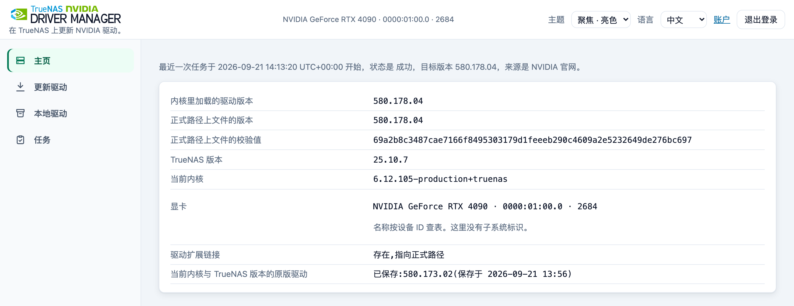
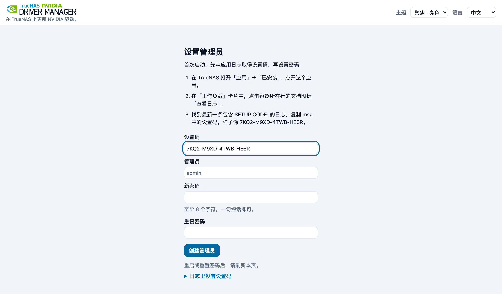
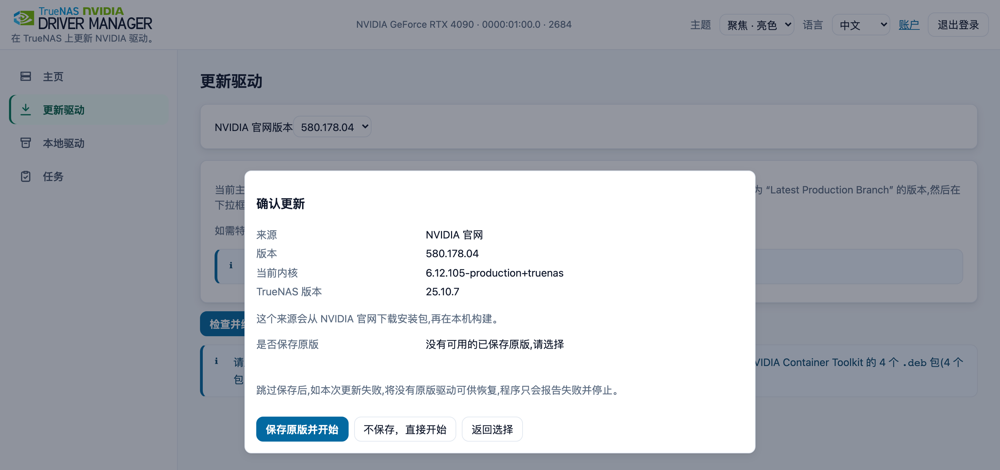

<p>
  <picture>
    <source media="(prefers-color-scheme: dark)" srcset="docs/images/lockup-dark.svg">
    
  </picture>
</p>

[English](README.md) | **简体中文**

在浏览器里更新 TrueNAS 机器上的 NVIDIA 驱动：选一个版本，确认后更新，页面会告诉你实际在用的是哪个驱动。

快速跳转：[安装](#安装) · [更新驱动](#更新你的驱动) · [出了问题怎么办](#出了问题怎么办) · [安全使用](#安全使用) · [更多文档](#更多文档)



## 它能做什么

- 列出适合你显卡的 NVIDIA 官网驱动版本。你也可以自己上传驱动文件，或者换回程序以前保存的驱动。
- 为你的 TrueNAS 版本准备好驱动，并替换现在的驱动。
- 更新后检查实际加载的是哪个版本。
- 保存原版驱动，需要时可以换回去。

## 它不会做什么

- 不会自己更新。每次更改都要你确认。
- 不会替你停应用：用到显卡的应用需要你自己先停。
- 不能保证一定恢复。新驱动没通过检查时，程序会尝试换回原版，但这一步也可能失败（见[更新你的驱动](#更新你的驱动)开头的警告）。

## 适合你的机器吗

- TrueNAS 25.10.7（Community Edition）或 TrueNAS 27.0.0-RC.1，电脑是 64 位的 Intel 或 AMD。其他版本和 ARM 电脑没有测试过。
- 有 NVIDIA 显卡。比较老的显卡有一些限制，见[为你的显卡选驱动](docs/operations.zh-CN.md#为你的显卡选驱动)。
- 机器需要能上网，用来下载驱动（nvidia.com）和构建工具（Docker Hub 和 Debian）。没有网络时，可以换用以前保存的驱动；上传的文件也能用，但要先按[部署说明](docs/deploy.zh-CN.md)备好构建所需的文件。

## 安装

1. 在 TrueNAS 里打开 NVIDIA 驱动。如果这个开关没打开，主页会显示提示。
   - 25.10.7：打开应用 → 已安装 → 配置 → 设置，勾选安装 NVIDIA 驱动程序，点保存。
   - 27.0.0-RC.1：打开系统 → 高级设置，在 NVIDIA Drivers 卡片点配置，勾选 Enable NVIDIA GPU Support，点保存。
2. 为程序单独建一个数据集。数据集是 TrueNAS 在存储池里建的一个目录，以后备份的就是它。
   1. 打开数据集，选中存储池，点添加数据集。
   2. 起名，例如 `nvm`。
   3. 在高级选项里，允许运行程序（`exec=on`）。
   4. 保存。

   全部要求见[部署说明](docs/deploy.zh-CN.md)。
3. 用 YAML（一小段文本，告诉 TrueNAS 这个应用怎么运行）安装应用。
   1. 打开应用 → 探索应用，点「自定义应用」旁边的 ⋮，选择「通过YAML进行安装」。
   2. 应用名称随便起。
   3. 粘贴下面的内容。
   4. 把 `<pool>` 和 `<dataset>` 换成你的存储池名和数据集名，保留后面的 `:/var/lib/nvm`。
   5. 保存。

```yaml
services:
  nvidia-driver-manager:
    image: ghcr.io/sky-zhang01/truenas-nvidia-driver-manager:latest
    restart: unless-stopped
    privileged: true
    pid: host
    runtime: runc
    volumes:
      - /mnt/<pool>/<dataset>:/var/lib/nvm
    ports:
      - "8199:8199"
```

> [!WARNING]
> `privileged: true` 和 `pid: host` 让应用能够控制这台机器本身。程序要换驱动，就需要这些权限。安装前请先读[安全使用](#安全使用)。

需要换端口、让应用使用独立地址，或者离线安装？见[部署说明](docs/deploy.zh-CN.md)。

4. 在应用日志里找到设置码。
   1. 等应用显示为运行中。
   2. 打开应用 → 已安装 → 你的应用 → 工作负载，在容器那一行点文档图标（查看日志）。
   3. 在最下面找最新一行含 `SETUP CODE:` 的记录。
   4. 复制它后面那四段字符，不要带引号和句号。这一行长这样，你的设置码会不同：

      ```json
      { "event": "setup_code_issued", "msg": "SETUP CODE: 7KQ2-M9XD-4TWB-HE6R. ..." }
      ```

   日志为空就等一分钟再打开。

5. 创建管理员。
   1. 在浏览器打开 `http://<nas-ip>:8199/`。`<nas-ip>` 是你平时打开 TrueNAS 用的地址。如果你给应用设了独立地址，就用那个地址（见[部署说明](docs/deploy.zh-CN.md)）。
   2. 输入设置码，保留用户名 `admin`。
   3. 设定至少 8 个字符的密码，输入两次。
   4. 点创建管理员，就会登录。



*仅为示例，你的设置码在应用日志里。*

设置码只能用一次，24 小时内有效。设置完成前重启应用会生成新的设置码，请用最新的一条。之后用 `admin` 和你的密码登录。

## 更新你的驱动

> [!WARNING]
> 换驱动会中断所有使用显卡的应用，而且恢复可能失败，请选在空闲时段进行。第一次更新时请保存原版驱动。另外请准备好直接操作这台机器的方式（TrueNAS 的系统 → 命令行，或接在机器上的键盘和显示器），以防显卡没有恢复。

1. 打开更新驱动，勾选你的显卡。
2. 选择 NVIDIA 官网版本。
3. 点「检查并继续」。
4. 停止标为「正在使用显卡」的应用（TrueNAS 里：应用 → 已安装 → 该应用 → 停止），检查会自动继续。如果等待已经结束，停完应用后点「重新检查」。
5. 在确认窗口里点「保存原版驱动并开始」。已经保存过原版时，点「开始更新」。
6. 等任务完成。关掉浏览器，任务也会继续。
7. 确认任务显示成功，主页上是新的版本。
8. 重启更新前已经在运行的显卡应用，包括主页「驱动版本已变更」里列出的应用，以及提示「Driver/library version mismatch」的应用。



原版驱动是你第一次选择保存时，TrueNAS 固定驱动位置上的那份驱动文件。每个内核（系统的核心部分）和 TrueNAS 版本的组合各存一份。最好在第一次更新前保存，这样存下的才是更新前的驱动。它不一定是 TrueNAS 自带的驱动：程序不检查它的来历。以后想换回去，打开本地驱动，选来源为「原版」的那一行，点「换回此版本」。这一步不需要联网。

可选：GeForce RTX 显卡的全速解锁。默认关闭，见[运维说明](docs/operations.zh-CN.md#显卡全速解锁gpu-unlock)。

每一步的截图、上传规则和其他细节，见[运维说明](docs/operations.zh-CN.md#更新驱动的详细步骤)。

## 出了问题怎么办

先打开主页，看现在加载的是哪个驱动。

- **更新一开始就失败了。** 若任务页写着没有改动任何东西，就按提示排除原因，再更新一次。再看使用显卡的应用还能不能启动，不能就重新启动它们。
- **显示「已恢复原版驱动」。** 新驱动没通过检查，原版已经换回来，你这次要的更新没有成功。如果没有保存过原版，程序只能报告失败，所以更新前请先保存。
- **显示「已中断」（断电或重启）。** 主页会写出已加载的驱动版本和停在哪一步。核对版本后再更新一次。如果应用还是用不了显卡，先在本地驱动里换回原版，然后在空闲时段重启机器。重启不一定能解决。
- **版本列表为空，或下载失败。** 机器必须能访问下载用的网站（nvidia.com、Docker Hub 和 Debian）。请检查它的网络设置和防火墙，再看任务日志。
- **设置码被拒绝，或忘记了密码。** 刷新页面，到应用日志里复制最新的设置码；也可以按[运维说明](docs/operations.zh-CN.md#忘记密码重置管理员账号)重置账号。

每个任务页都有日志。如果你以前用过别的 NVIDIA 驱动工具，它可能在每次开机时装回自己的驱动，让这里的更新失效，见[运维说明](docs/operations.zh-CN.md#排错与报告问题)。

## 安全使用

- 请备份安装第 2 步建的数据集，里面有你的账号、任务记录，以及保存下来的驱动，包括原版驱动。
- 程序对这台机器的权限和 TrueNAS 管理员相当。能登录它的人，就能控制驱动和这台机器。
- 页面走明文 HTTP，传输的内容不加密，默认整个内网都能打开。请限制在可信的管理网络里使用，不要把这个端口转发到互联网。
- 首次启动后尽快完成设置。在此之前，读得到应用日志的人都能使用设置码。
- 请用强密码，并且只上传你信任的文件。上传的安装包会在你的机器上运行，并成为系统的一部分。

## 更多文档

- [部署说明](docs/deploy.zh-CN.md)：网络方式、升级与固定应用版本、离线安装与构建。
- [运维说明](docs/operations.zh-CN.md)：分步更新、为显卡选驱动、上传、本地驱动、换回原版、SSH 密钥登录、重置密码、备份、日志。
- [安全说明](docs/security.zh-CN.md)：程序的工作方式、需要的权限和已知限制。
- [智能体说明](docs/agent.zh-CN.md)：让 Claude Code、Codex 这类 AI 智能体来做更新。登录之后，智能体拥有完整的管理员权限，程序也无法确认它是不是先问过你。
- [安全报告](SECURITY.zh-CN.md)、[贡献指南](CONTRIBUTING.zh-CN.md)、[更新记录](CHANGELOG.zh-CN.md)。
- 遇到问题请提交 issue，需要附的信息见[运维说明](docs/operations.zh-CN.md#排错与报告问题)。

## 许可与致谢

源代码采用 MIT 许可，但 `third_party/gpu-unlock/` 里的 gpu-unlock 内核模块除外，它采用 GPL-2.0-only 许可。见 [`LICENSE`](LICENSE)。

程序的镜像不包含 NVIDIA 驱动，也不包含解锁固件。使用官方来源更新时，驱动由你的机器从 NVIDIA 下载，上传的安装包由你自己提供。NVIDIA 驱动软件受 NVIDIA 许可条款约束。

Debian 补丁、构建脚本和解锁模块的致谢见 [`THIRD_PARTY_NOTICES.md`](THIRD_PARTY_NOTICES.md)。

本项目与 iXsystems 或 NVIDIA 无关联，未获其背书。TrueNAS 是 iXsystems, Inc. 的商标，NVIDIA 是 NVIDIA Corporation 的商标。标志和品牌素材（包括画进图里的字标）不适用 MIT 许可，权利归各自所有者。
