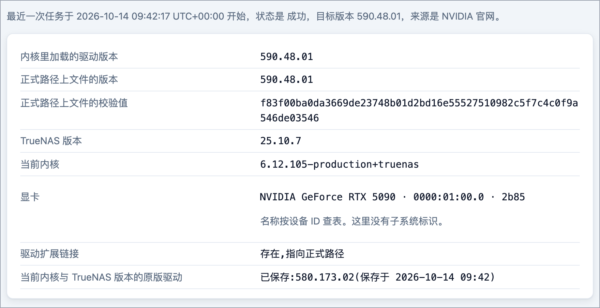

<p>
  <picture>
    <source media="(prefers-color-scheme: dark)" srcset="docs/images/lockup-dark.svg">
    
  </picture>
</p>

在网页上给你的 TrueNAS 更新 NVIDIA 驱动。选好版本，点确认，剩下的安装和检查交给管理器。

**快速跳转：**[开始之前](#开始之前) · [安装](#五步安装) · [更新驱动](#更新你的驱动) · [重启显卡应用](#6-重启使用显卡的应用) · [出了问题怎么办](#出了问题怎么办) · [安全使用](#安全使用) · [常见问题](#常见问题) · [English](README.md)



*主页显示当前加载的驱动、你的显卡，以及原版驱动是否已保存。*

## 它能帮你做什么

你新买了 NVIDIA 显卡，或者某个游戏、AI 工具、媒体应用需要比 TrueNAS SCALE 自带更新的驱动。TrueNAS 自己没有换驱动的按钮。

这个工具补上了这个按钮。它是一个普通的 TrueNAS 应用，你在浏览器里使用。下文把它叫作“管理器”。

1. 列出你可以选择的驱动版本。
2. 为你的 NAS 准备好驱动并安装。
3. 检查新驱动是否真的加载成功。
4. 保存 TrueNAS 自带的驱动（下文叫“原版驱动”），需要时可以换回去。

每一步改动都要你确认，不会自动更新。如果更新后的检查没通过，而且已经保存了原版驱动，管理器会尝试把原版换回来。这个恢复也可能失败，所以更新后一定要在主页确认结果。

## 开始之前

- TrueNAS SCALE **25.10.7**，常见的 64 位 x86 电脑（amd64）。这是目前唯一测试过的环境。
- NAS 里有一张 NVIDIA 显卡。
- 已在 TrueNAS 启用 NVIDIA 驱动：在**应用 → 已安装**页面点**配置 → 设置**，勾选**安装 NVIDIA 驱动程序**。管理器要在这个基础上替换驱动，所以它得先存在。如果没有启用，管理器的主页会提示你。
- 为管理器单独准备一个数据集（存储池里的一个存储目录）。在 TrueNAS 打开**数据集**，选中你的存储池，点**添加数据集**，起个名字，例如 `nvm`。它的目录就是 `/mnt/<pool>/nvm`，其中 `<pool>` 是你的存储池名字。数据集要允许运行程序（ZFS 设置 `exec=on`），可在新数据集的**高级选项**里确认。具体要求见[部署说明](docs/deploy.zh-CN.md)。
- NAS 能访问互联网，能够访问 NVIDIA 下载站、Docker Hub 和 Debian 软件包存档。没有网络时，请看[部署说明](docs/deploy.zh-CN.md)里的离线方式。
- 选一个没人用 NAS 的空闲时段，并确保能直接操作 NAS：TrueNAS 的命令行，或者接在 NAS 上的键盘和显示器。

> [!WARNING]
> 换驱动会中断所有使用显卡的应用。请选空闲时段。第一次更新前先保存原版驱动，并准备好直接操作 NAS 的方式，以防显卡没有恢复。
>
> 安装用的 YAML 文件会申请扩展权限（`privileged: true` 和 `pid: host`）。管理器要靠它们来更换 NAS 本机的驱动。所以请先读一下[安全使用](#安全使用)。

## 五步安装

### 1. 打开 YAML 安装入口

在 TrueNAS 中打开**应用 → 探索应用**。点「自定义应用」旁边的 **⋮**（「更多选项」），选择**通过YAML进行安装**。应用名称随便起。

### 2. 粘贴 YAML，填写数据目录

在 GitHub 上打开 [`deploy/compose.yaml`](deploy/compose.yaml)，点复制按钮，把全部内容粘贴到 YAML 框里。把 `/mnt/<pool>/<dataset>` 换成你准备的数据集目录（数据目录）：`<pool>` 是存储池名字，`<dataset>` 是数据集名字，例如 `nvm`。后面的 `:/var/lib/nvm` 保持不变。

### 3. 保存并启动应用

其余行保持原样，保存。这个文件会把管理器发布在 NAS 的 8199 端口（“bridge”方式），其他网络方式见[部署说明](docs/deploy.zh-CN.md)。TrueNAS 保存时会去掉 YAML 里的注释，这是正常的。

### 4. 从日志复制设置码

1. 等应用显示为运行中，打开**应用 → 已安装 → 你的应用 → 工作负载**，在容器那一行点文档图标（**查看日志**）。如果日志是空的，等一分钟再打开。
2. 找最新的 `setup_code_issued` 事件：**最新的日志在最下面**。每条日志都是 JSON，设置码在它的 `msg` 文字里，以 `SETUP CODE:` 引出。
3. 只复制 `SETUP CODE:` 后面的四组设置码，不带引号和句号。你的设置码与下面的示例不同。

其余字段和 msg 后面的内容已省略（“...”）；实际日志是单独一行。

```json
{
  "event": "setup_code_issued",
  "msg": "SETUP CODE: 7KQ2-M9XD-4TWB-HE6R. ..."
}
```

### 5. 创建管理员账号

`<nas-ip>` 是平时打开 TrueNAS 用的地址，家庭网络里通常以 `192.168.` 开头。如果给应用单独分配了地址（macvlan），则用那个地址，见[部署说明](docs/deploy.zh-CN.md)。

1. 在浏览器打开 `http://<nas-ip>:8199/`。
2. 输入设置码，保留已填好的用户名 `admin`。
3. 设定至少 8 个字符的密码，并输入两次。
4. 点**创建管理员**。你就登录了，可以开始更新。

如果设置码被拒绝，请看常见问题里的[设置码被拒绝、已过期或找不到。](#常见问题)


*仅为示例。请到应用日志里取你的设置码，输入后设定管理员密码。*

设置码只能使用一次，24 小时内有效。设置完成前重启应用会生成新的设置码，所以请始终用最新的一条。设置码只用于第一次启动。以后打开同一个地址，用 `admin` 和你的密码登录即可。之后重启应用不需要设置码。

## 更新你的驱动

### 1. 选择驱动版本

1. 在左侧菜单里打开**更新驱动**（窄屏时菜单在页面底部）。如果有不止一张 NVIDIA 显卡，勾选将使用这个驱动的显卡。
2. 点开“NVIDIA 官网版本”下拉框选择版本。
3. 不确定时，点“NVIDIA 官网链接”找到标着 “Latest Production Branch” 的版本，如果下拉框里有，就选它。
4. 点**检查并继续**。

**上传 .run** 按钮用于你自己下载的安装包，见下文的[驱动来源](#驱动来源)。


*选好 NVIDIA 官网版本，先检查再继续。*

### 2. 看检查结果

确认之前，管理器会先检查显卡、内核和正在运行的应用。如果列出了仍在使用显卡的应用，请自己先停掉它们，再重试。管理器不会替你停止任何应用。

### 3. 保存原版并确认

弹窗会显示来源、版本和你的系统信息。如果问你是否保存原版驱动，请选**保存原版并开始**，这样最稳妥。如果原版已经保存过，按钮会显示为**开始更新**。


*核对版本和系统信息，开始前先保存原版驱动。*

### 4. 等待任务完成

任务页会显示当前阶段；实时日志在页面下方。同一时间只运行一个更新，关掉浏览器也不影响它继续运行。下载和构建默认共用 30 分钟的时限；如果在驱动文件被替换之前超时，更新会停止，驱动文件保持不变。


*任务页会突出显示当前阶段。*

### 5. 查看结果

任务状态为**成功**，更新后的检查会显示你的新版本。主页显示的版本也一致。


*确认任务成功，并核对更新后检查里的版本。*

### 6. 重启使用显卡的应用

更新后，请重启使用显卡的应用。如果主页在“驱动版本已变更”下列出了应用，就重启这些应用。如果某个应用启动失败，提示类似 “Driver/library version mismatch”，也请重启这个应用。

<details>
<summary>本地驱动：已保存的版本与可用操作</summary>

**本地驱动**页列出管理器构建或保存过的驱动。在它们之间切换，不用重新下载。


*本地驱动页会标出正在使用的版本，并保留已保存的版本供切换。*
</details>

### 驱动来源

驱动有三种来源：

- **NVIDIA 官网版本。** 由 NAS 从 NVIDIA 官网下载驱动。上面介绍的就是这种，也是大多数人该用的方式。
- **你上传的文件。** 需要你自己从 NVIDIA 下载 Linux 安装包（`.run` 文件），再加上“更新驱动”页上列出的四个辅助软件包。
- **之前保存过的驱动。** 切换过去不用再下载。

## 出了问题怎么办

- **更新在替换驱动文件之前就失败了。** 驱动文件没有改动。看任务页上的提示，排除原因后重新更新。驱动模块可能已经被卸载，所以请确认使用显卡的应用还能启动，不能的话就重启它们。主页会显示当前加载的是哪个驱动。
- **新驱动没通过检查，且已保存原版。** 管理器会尝试换回原版驱动。如果任务显示“已恢复原版驱动”，表示恢复成功，不表示更新成功。
- **没有保存原版。** 管理器只能报告失败。所以建议先保存原版。
- **你想换回原版驱动。** 打开**本地驱动**，选来源为**原版**的那一行，点**用这个版本检查并继续**。这一步不需要联网。
- **设置码被拒绝、已过期或找不到。** 请看常见问题里的[设置码被拒绝、已过期或找不到。](#常见问题)
- **任务显示“已中断”**（断电、主机重启）。打开主页，那里会显示已加载的驱动版本和停在哪一步。核对版本后再更新一次。如果应用仍然用不了显卡，先在**本地驱动**里切换到**原版**那一项，再在空闲时段重启 NAS，让 TrueNAS 重新加载当前驱动。重启不保证一定能恢复。

如果恢复失败，你需要能直接操作 NAS。每个任务页都有日志。所有情况的详细说明见[运维说明](docs/operations.zh-CN.md)。

## 安全使用

- **管理器能改动你的 NAS。** 它拥有和 TrueNAS 管理员相当的权限。能登录它的人，就能控制驱动和主机。
- **只在家庭内网使用。** 页面是明文 HTTP，默认整个内网都能访问。不要把端口转发到互联网。
- **首次启动后尽快完成设置。** 在此之前，能读取应用日志的人都可以使用设置码。
- **用强密码**，并且只上传你信任的文件。上传的安装包会在你的 NAS 上运行，并成为系统的一部分。
- **先保存原版驱动，并备份数据目录。** 数据目录里有你的账号、任务记录和保存的驱动，包括原版驱动。

其余内容，比如构建时占用的资源，见[安全说明](docs/security.zh-CN.md)。

## 常见问题

<details>
<summary>它会自己更新吗？</summary>

不会。每次改动都要你在确认弹窗里点一下。
</details>

<details>
<summary>能用在其他 TrueNAS 版本或 ARM 上吗？</summary>

只测试过 TrueNAS SCALE 25.10.7 / amd64，其他版本和芯片都没测试。列表里有某个版本，不等于它一定适合你的显卡和应用。确认前请先看检查结果和警告。
</details>

<details>
<summary>版本列表是空的，或者下载失败。</summary>

NAS 需要能访问 NVIDIA 下载站、Docker Hub 和 Debian 软件包存档。请检查防火墙和 DNS，再看任务日志。列表里的版本还取决于你勾选的显卡，较老的显卡只会看到它能用的版本。
</details>

<details>
<summary>更新到一半停了。</summary>

打开主页和任务页，会看到停在哪一步以及已加载的驱动版本。每个阶段的含义见[运维说明](docs/operations.zh-CN.md)。
</details>

<details>
<summary>设置码被拒绝、已过期或找不到。</summary>

1. 刷新管理器页面。设置码过期后，日志里会写入新的设置码。
2. 再次打开应用日志，复制最新一条包含 `SETUP CODE:` 的日志里的设置码。最新的日志在最下面。只复制四组设置码，不要带引号。
3. 如果没有这样的日志，在**应用 → 已安装**里重启应用，等一分钟，再看日志。
4. 如果页面提示稍后再试，请等到它显示的时间。输错设置码和输错密码共用同一个次数限制。
</details>

<details>
<summary>我忘了密码。</summary>

1. 在 TrueNAS 里打开 NAS 本机的命令行（**系统 → 命令行**）。管理器自己的命令行按钮点了没反应，不要用它。
2. 删除数据目录里的账号文件 `web-credentials.json`。命令里的 `<数据目录>` 换成你在 YAML 里填的路径，也就是 `:/var/lib/nvm` 前面那一段。这会删除账号和已保存的 SSH 密钥，并让所有设备退出登录，驱动和任务不受影响：

   ```sh
   rm '<数据目录>/manager/secrets/web-credentials.json'
   ```

3. 刷新页面，页面会重新显示设置页，应用会把新的设置码写进日志。
4. 在 TrueNAS 打开**应用 → 已安装**，点你的应用，在**工作负载**卡片里点容器那一行的文档图标（**查看日志**）。复制最新一条包含 `SETUP CODE:` 的日志里的设置码。如果没有出现新的日志，再刷新一次页面；还是没有就重启应用。
5. 输入设置码，设定新密码。不需要重启应用。如果你用 SSH 密钥，需要重新登记。

详细步骤见[运维说明](docs/operations.zh-CN.md)。
</details>

<details>
<summary>TrueNAS 里这个应用的命令行按钮点了没反应。</summary>

管理器的镜像里没有 shell，这是正常的。排查请看任务页。
</details>

<details>
<summary>怎么升级或删除管理器本身？</summary>

先备份数据目录。使用 `latest` 标签时，打开**应用 → 已安装**，点你的应用，有新镜像时在**应用信息**卡片上选 **⋮ → 更新**。想换到固定版本，就点**编辑**，把镜像标签改成版本号后保存。改动应用本身不会改变 NAS 上的 NVIDIA 驱动。如果想换回原版驱动，请先在**本地驱动**里操作。详情见[部署说明](docs/deploy.zh-CN.md)。删除管理器的分步说明还没有写。

YAML 里的镜像标签是 `latest`。想固定在某个版本，可以改成 `0.2.1`：`ghcr.io/sky-zhang01/truenas-nvidia-driver-manager:0.2.1`。
</details>

## 进阶用户

- [部署说明](docs/deploy.zh-CN.md)：网络方式（bridge、macvlan、ipvlan）、应用升级与回退、离线安装与离线构建、联网下载来源。
- [运维说明](docs/operations.zh-CN.md)：换回原版驱动、排错、SSH 密钥登录、重置密码、备份、中断任务、日志。
- [安全说明](docs/security.zh-CN.md)：管理器的工作方式、需要的权限、会话处理、TLS 与已知限制。
- [智能体说明](docs/agent.zh-CN.md)和[智能体技能](skills/nvidia-driver-replacement/SKILL.md)：让 Claude Code、Codex 这类 AI 智能体来做更新。智能体会被要求每次替换前先问你，但管理器无法确认它是否真的问了。登录后的智能体拥有完整的管理员权限。
- [安全报告](SECURITY.zh-CN.md)、[贡献与本地开发](CONTRIBUTING.zh-CN.md)、[更新记录](CHANGELOG.zh-CN.md)。

<details>
<summary>可选：验证镜像确实来自本仓库</summary>

```bash
gh attestation verify oci://ghcr.io/sky-zhang01/truenas-nvidia-driver-manager:0.2.1 --repo sky-zhang01/truenas-nvidia-driver-manager
```
</details>

## 获取帮助

提交 issue 时请附上：管理器版本、TrueNAS 和内核版本、显卡型号、驱动来源和目标版本、任务状态和任务日志。贴日志前先去掉其中的地址、路径、密码和密钥。安全问题请按 [SECURITY.zh-CN.md](SECURITY.zh-CN.md) 私下报告。

## 许可与商标

源代码采用 MIT 许可，见 [`LICENSE`](LICENSE) 和 [`THIRD_PARTY_NOTICES.md`](THIRD_PARTY_NOTICES.md)。

本项目**与 iXsystems 或 NVIDIA 无关联，也未获其背书**。TrueNAS 是 iXsystems, Inc. 的商标，NVIDIA 是 NVIDIA Corporation 的商标。标志和品牌素材（包括其中的字标）不适用 MIT 许可，权利归各自所有者。

管理器的镜像不包含 NVIDIA 驱动。使用官方来源更新时，由你的 NAS 从 NVIDIA 下载；上传的安装包由你自己提供。NVIDIA 驱动软件受 NVIDIA 许可条款约束，与本项目的 MIT 许可相互独立。
