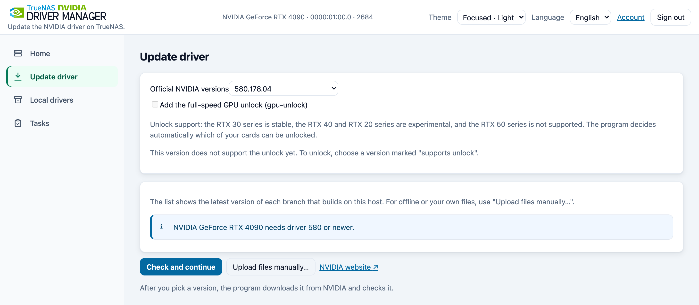
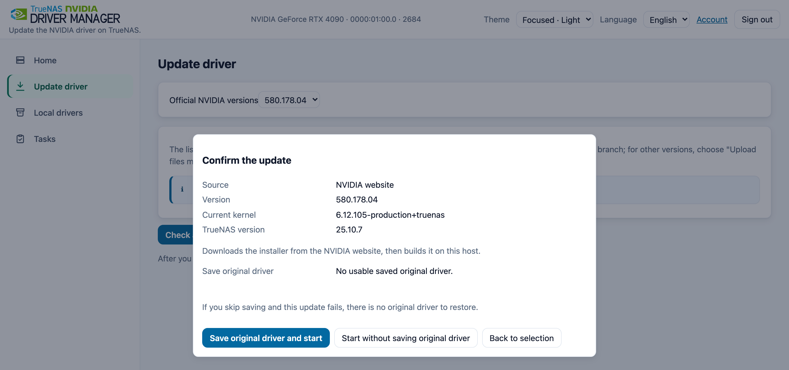
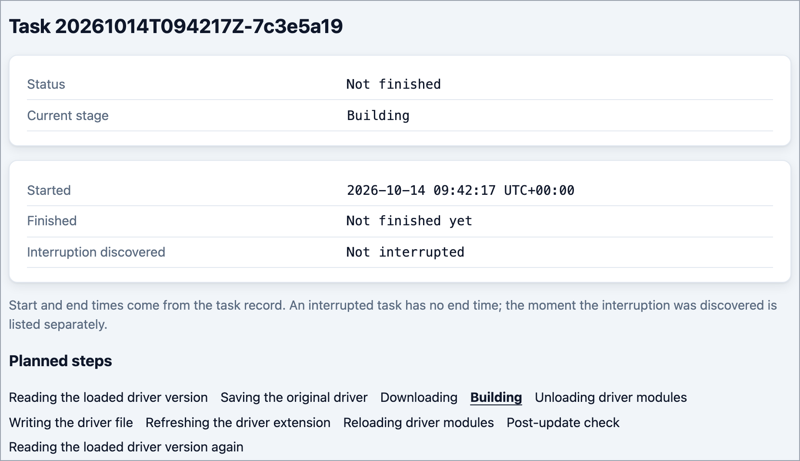
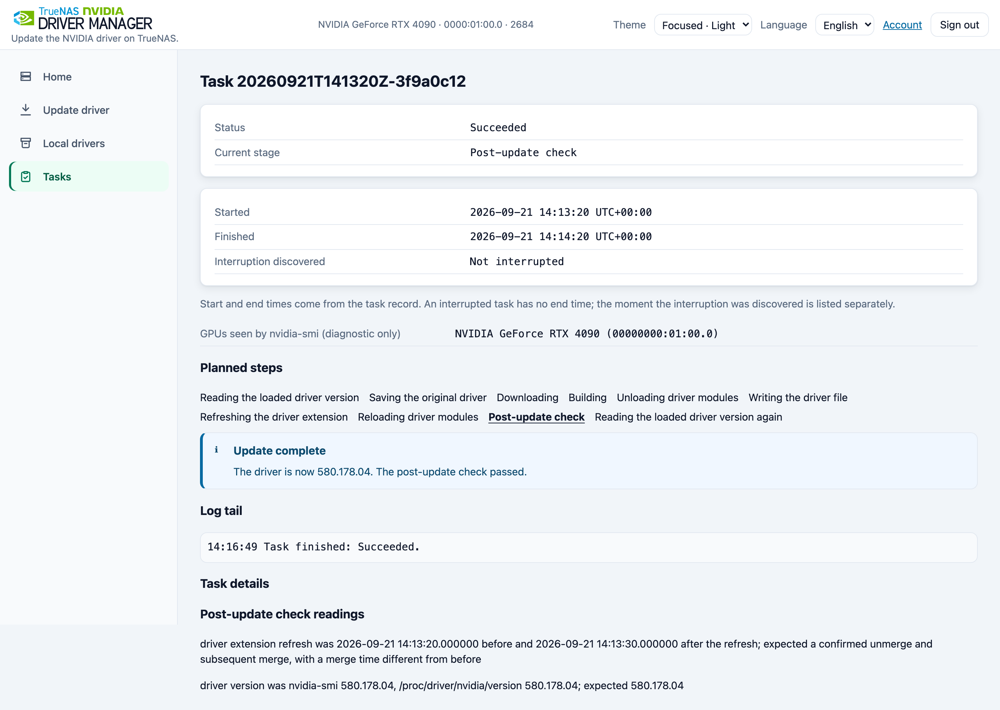
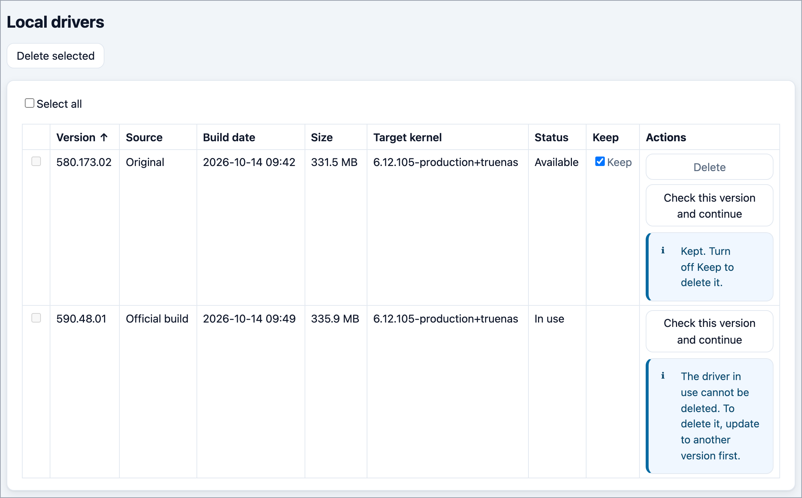

# Operations guide

[简体中文](operations.zh-CN.md)

## Updating a driver, step by step

The short version is in the [README](../README.md#update-your-driver). This section has the details behind each step.

**1. Choose GPUs and a driver.**

1. Open Update driver in the menu on the left (at the bottom on a narrow screen). With more than one NVIDIA GPU, tick the GPUs that will use the driver.
2. Open the "Official NVIDIA versions" list and pick a version. It shows the newest version of each driver series that builds on this host. For another version, choose the last item, "Other version…", and type the version number. Versions that NVIDIA's website does not have are refused before the update starts.
3. If you are unsure, open "NVIDIA website ↗", find "Latest Production Branch", and pick that version here if it is listed.
4. Click Check and continue.

For offline use or your own files, choose Upload files manually… (see [Manual uploads](#manual-uploads-and-returning-from-confirmation)). The manager can take a driver from three places: the official NVIDIA list (the host downloads it), files you upload, or a local driver it saved before (no download).



**2. Check GPU use.** While the check runs, the page lists the apps that use or request the GPU and refreshes the list by itself. Stop the apps marked "Using the GPU now"; the check then continues on its own. If the GPU is still in use after about 30 seconds, the result window shows when the list was taken. Stop the apps and choose "Check again". The manager never stops apps for you.

**3. Confirm the update.** Check the source, version and system in the confirmation window. Choose "Save original driver and start" when it is offered, or "Start update" when the original is already saved.



**4. Follow the task.** The task page shows the current stage, with the live log further down. Only one update runs at a time, and it keeps running if you close the browser. Downloading and building share a default limit of 30 minutes (`NVM_BUILD_TIMEOUT_MINUTES`). Building makes the driver ready for the current kernel. If the limit runs out before the driver file is replaced, the update stops and the file stays unchanged.



**5. Verify the result.** The task ends as Succeeded, the post-update check shows your new version, and Home shows the same version.



**6. Restart GPU apps.** Restart the GPU apps that were running before the change. Home lists affected apps under "Driver version changed". Apps that report "Driver/library version mismatch" also need a restart.

## Choosing a driver for your GPU

- **Which kind of driver module.** For driver versions 555 and later, the manager looks at the GPUs you ticked. If any of them needs the closed-source module (this includes Maxwell, Pascal and Volta cards), it builds the closed-source module. Otherwise it builds the open-source one. The last driver series that supports Maxwell, Pascal and Volta is 580. Those three card generations have not been tested on TrueNAS 27.
- **Older cards.** A version in the list does not promise that it works with your GPU or apps. Read the checks and warnings before you confirm. An old GPU only sees the versions it can use.
- **Kepler cards** (including some GTX 600 and 700 models): choose official 470.256.02. It is offered on TrueNAS 25.10 (kernel 6.12) and TrueNAS 27 (kernel 6.18). The manager downloads Debian's community compatibility patches and applies them. Patching and compiling have been tested against the kernels of TrueNAS 25.10.7 and 27.0.0-RC.1. Loading, display and CUDA (NVIDIA's software for running calculations on the GPU) on real Kepler hardware have not been verified. NVIDIA no longer maintains the 470 series or publishes security fixes for it. Use it only for GPUs that have no other supported driver.
- **Patches apply only to the official 470.256.02 build.** Manually uploaded 470 installers do not receive them. The patch archive has to be downloaded over the network, so it cannot be placed in `manager/build-kit/` beforehand. The build packages can be.
- **IBT.** These Debian patches make 470 refuse to load when the kernel has IBT (Indirect Branch Tracking, a CPU security feature) turned on. The patch notes name Intel 11th-generation and newer CPUs. In the TrueNAS Shell, run `grep '^flags[[:space:]]*:' /proc/cpuinfo | grep -c -w ibt` to count the lines that report `ibt`. A result of 0 only means this command found no match; it does not show that 470 can load. With no match the command also exits with status 1.

## Local drivers

The Local drivers page lists the drivers the manager has built or saved. You can switch to a driver that was built for the current kernel without downloading it again. Drivers built for a different kernel show "Kernel mismatch". To use one, select that version on Update driver if it is listed, or upload its installer again; the update rebuilds the driver for the current kernel. An original driver saved for a different kernel cannot be used. A driver built with the unlock shows "· with full-speed unlock" in the Source column.



## Return to the saved original driver

In Local drivers, choose a usable Original row, click Restore this version, and confirm the plan. This uses the saved driver image without downloading or building. The original is the driver file at the permanent path when you first choose to save it for the current kernel and TrueNAS version; the manager does not determine whether TrueNAS supplied it. It requires an original compatible with the current kernel and TrueNAS version; an NVIDIA download cannot supply that saved image.

The automatic restore path runs after a replacement's driver check fails, when a usable original
copy exists. It does not cover every download, build, unload, or write failure, and restoration
can fail too. With `STOCK_RESTORED`, the original driver is back and the requested update failed.
Inspect task check records and loaded versions; app availability must be checked separately.

## Troubleshooting and reporting a problem

First read the home-page blockers, task status, error, and check records. Download/build failures
can come from unreachable NVIDIA, Docker Hub, or Debian snapshot endpoints. For the official
`470.256.02` driver on `6.12` or `6.18` kernels, the host also downloads a community patch archive
from snapshot.debian.org, the same source as the build packages. Fix connectivity
or prepare the offline inputs in the [deployment guide](deploy.en.md), then confirm a new plan.
Do not repeatedly submit while a task is running or its state is unreadable.

For a public issue, include the manager version/image tag, TrueNAS and kernel versions, GPU
model, selected source and target, task status, and redacted logs. Remove host addresses, local
paths, credentials, cookies, tokens, and private keys. Report suspected vulnerabilities through
[SECURITY.md](../SECURITY.md). Keep unresolved recovery files until the manager's checks allow
release; do not delete task directories to bypass a block.

If the version list is empty or a download fails, first check that the host can reach NVIDIA's download site, Docker Hub and Debian's package archive. Check your firewall and DNS (DNS turns a site name into an address), then read the task log. The versions shown also depend on the GPUs you ticked.

If the setup code is rejected, expired or missing: reload the manager page, because an expired code is replaced by a new one in the logs. Then copy the code from the newest log line that contains `SETUP CODE:` (the newest line is at the bottom). If there is no such line, restart the app from Apps → Installed, wait a minute and read the logs again. If the page says to try again later, wait the number of seconds shown; wrong codes and wrong passwords share one limit. To reset the account, see [Forgot the password](#forgot-the-password-resetting-the-administrator-account).

If a tool you used before puts its own driver back at boot, a restart may replace the driver this manager installed. The manager does not change that tool's boot settings. You decide whether to turn it off.

## Manual uploads and returning from confirmation

On Update driver, choose Upload files manually…. The window lists one `.run` driver
installer and four amd64 toolkit `.deb` packages of the same version, with official download
links beside each row. The four packages are the NVIDIA Container Toolkit, which lets apps in containers use the GPU; a `.deb` file is a Debian software package, and amd64 means it is for 64-bit Intel or AMD computers. The toolkit version comes from the official index, with `1.20.1-1` used
when it cannot be read. Skip `-dev`, `-dbg` and checksum files. The driver version at the top
only generates download links; the file content determines the version to install.

Choosing files starts the upload immediately, with `.deb` files first and `.run` last. Check
each row's state, reason and suggested action. The footer shows the ready count while files are incomplete, then a completion summary. The progress
bar has no percentage while the manager reads a file. Cancel upload asks for confirmation,
deletes the partial file and keeps files already received. Use Clear and start again to
replace the whole group. Unused-file notices can be dismissed individually.

Once all five are ready, choose Check and continue. The window stays open during the check
and on failure so you can resolve the problem. It opens confirmation only after success.
Back to selection returns to the checklist with the files kept. Canceling a plan releases its lock
on the staged files. Once the task starts, its uploaded files cannot be replaced. Fingerprints
and checksums are under File details in confirmation.

The manager checks content, architecture and versions and runs the installer's own integrity
check at build time. It does not verify NVIDIA signatures or compare official checksums. Passing
these checks does not prove the source is trustworthy. Offline builds also need the build image
and packages in the [deployment guide](deploy.en.md).

## SSH key sign-in

Register SSH public keys on the Account page. To sign in, expand "Sign in with an SSH key",
copy the one-time challenge, sign it in your terminal, and paste back the signature.
Password sign-in remains available.

- Accepted key algorithms: `ssh-ed25519`, `ecdsa-sha2-nistp256`, `ecdsa-sha2-nistp384`
  (no RSA, sk-* or certificates). At most 5 keys.
- Only public keys and signatures reach the server. Private key material pasted into a
  public-key, comment or signature field is refused and cleared before transmission.
- Registration lives in the "SSH sign-in keys" section of the Account page; keys can be
  registered immediately after setup.
- The terminal signing command (replace `<challenge>` with the current challenge on
  the page):

  ```sh
  printf '%s' '<challenge>' | ssh-keygen -Y sign -f ~/.ssh/id_ed25519 -n nvm-login
  ```

  ssh-agent / 1Password work too (the export must be its own line):

  ```sh
  export SSH_AUTH_SOCK=~/.1password/agent.sock
  printf '%s' '<challenge>' | ssh-keygen -Y sign -f <(ssh-add -L) -n nvm-login
  ```

  With several keys in the agent, `<(ssh-add -L)` silently picks the first one; use
  the signing command under each key on the Account page, or point `-f`
  at the registered public key file. 1Password needs its SSH agent enabled in its
  settings.
- Deleting a key immediately ends every signed-in session (this browser receives a
  replacement cookie and stays online; other devices sign in again); password
  sign-in is unaffected.
- Failed SSH sign-ins, failed password sign-ins, and wrong setup codes share one rate-limit bucket.

## Forgot the password: resetting the administrator account

The credentials file lives in the data directory:
`<data-directory>/manager/secrets/web-credentials.json`. To reset it:

1. Open the host's Shell in the TrueNAS web UI (System → Shell) or log in to the host
   over SSH. The app's own Shell button cannot be used: the image is empty-base (`scratch`) and
   carries no shell (see the [deployment guide](deploy.en.md)).
2. Delete the credentials file. This resets the account and removes all registered SSH keys;
   it does not delete drivers or tasks:

   ```sh
   rm '<data-directory>/manager/secrets/web-credentials.json'
   ```

3. Without restarting the app, reload the manager page. It shows setup and writes a new
   code to the app logs. In TrueNAS, open Apps → Installed → this app → Workloads and click
   the container row's document icon, View Logs. Copy the whole code from `msg` in the newest
   JSON log message containing `SETUP CODE:`.
4. Enter that code on the manager page, choose and repeat a new password, and click
   Create administrator. Register any needed SSH public keys again.

Notes:

- Deleting this file removes the account, its SSH keys and all existing sessions. Task state,
  local driver records and the saved original are unaffected. The data folder is the host directory
  you entered in the YAML volume mapping; the login page shows a generic credentials path with
  a data-folder placeholder.
- A code works once, expires after 24 hours, and is invalidated by an app restart. After expiry,
  reopening the page or submitting setup writes a new code; copy the code from `msg` in the
  newest log message containing `SETUP CODE:`. A live code is never replaced just because
  someone submits a wrong code.
- The setup code appears only in the `msg` of the `setup_code_issued` app log event. It is never
  written to task logs or task state. App log readers and collectors can see it while it is live;
  redact setup-code messages before sharing logs. Passwords, hashes, challenges, signatures,
  full public keys and session tokens are not logged.
- Setup, password and SSH sign-in share rate limits. Once the quota is exhausted, a correct
  code or password is temporarily refused too; wait for the displayed retry time. There is no
  permanent lockout. A reachable attacker can delay sign-ins by exhausting the quota; restrict
  access to a trusted management network. Restarting clears the quota and invalidates any
  pending setup code.
- Setup codes and passwords need a trusted connection; plain HTTP exposes both in transit.
  Configure a TLS front end when a trusted management LAN is insufficient.

Returning to 0.2.0 after creating an account through setup is unsupported. Keep the pre-upgrade
backup if you need to return to that release.

## Backup and restore

- Back up the data directory: the credentials file, the task state and logs, and the local driver
  records (including the saved original driver file).
- `<data-dir>/manager/build-kit-cache/` holds the verified build packages (about 88 MiB). It can be
  deleted at any time; the next build downloads those packages again.
- `<data-dir>/manager/gpu-unlock/firmware/` holds the verified unlock firmware (about 114 MB) once an update with the unlock has run. It can be deleted at any time; the next update with the unlock generates it again from the installer.
- To restore, put the whole data directory back in place and start the app with the same compose
  file. The credentials file decides the account and password in use; restore it too and you do not
  have to rebuild the account.

## Loaded module alignment

After update or original-driver restoration, the loaded kernel driver version is read. The task enters Aligning loaded driver modules if another component loaded the previous image's modules, the version file is missing, or different image bytes with the same version leave the full version text unchanged. During restoration the title starts with Restoring the original driver. Unparseable text proceeds directly to the post-update check.

Before the image is written, again before the alignment round unloads anything, and again before
a restore unload, the manager reads `/proc/modules`. If the GPU is in use it waits, re-reading
about every 0.2 seconds, for at most about 30 seconds, and continues as soon as every `nvidia*`
module's reference count drops to the number of modules that depend on it. An unreadable reading
does not wait. Container start, health checks, and `exec` through the NVIDIA runtime can hold
the GPU for a moment. On TrueNAS 27, after the `nvidia` module loads, `nvidia-cdi-refresh` holds
the GPU for about 10 seconds, which is inside that wait. The update stops only when the GPU is
still in use after the wait: no module is unloaded and the file on the permanent path stays
unchanged. The alignment round and the restore pass wait the same way. If the alignment round is
still busy after the wait, that round does not unload or reload, and the normal post-update check
decides the result.

An `rmmod` that fails because the module is in use uses the same interval and the same cap of
about 30 seconds, then tries `rmmod` again. Container health checks and `exec` through
`nvidia-container-runtime` can open an idle GPU for about two seconds, about every three seconds,
so the occupancy reading can already be idle while the following `rmmod` is still refused. The
program does not force-unload (`rmmod -f`), stop or mask any service, or change Docker
configuration. If the first unload is still refused after the wait, the task fails, modules
already unloaded are loaded again in reverse order, and the file on the permanent path stays
unchanged. If an alignment-round unload is still refused after the wait, that round stops and
the normal post-update check decides the result. Each wait is recorded with how long it lasted,
how many retries it made, and how it ended.

Reload targets are `nvidia`, `nvidia_drm`, and `nvidia_modeset`, plus any other driver module
that was loaded when the task started, such as `nvidia_uvm`. Modules that others depend on load
first. The restore pass and the alignment round use that same stored set. When the start reading
cannot be read, the previous rule stays: an empty unload reloads `nvidia`, then `nvidia_drm`,
then `nvidia_modeset`.

This stage makes at most one additional unload/reload round from the current module list. If the
core module cannot be removed, dependent modules are not reloaded. The reload targets stored at
the start stay fixed; this stage neither rewrites nor refreshes the image. Its actions and version
readings are recorded separately from the first round. The normal post-update check still decides
the result: an unsuccessful update can restore the saved original once; an unsuccessful restore
ends with a restore-check failure.

## Full-speed GPU unlock (gpu-unlock)

This optional feature lifts the half-rate limit GeForce cards put on FP16, BF16 and TF32 tensor math with FP32 accumulation. It uses the GPL-2.0-only kernel module of Zagitta/gpu-unlock 2.0.0, vendored unchanged in `third_party/gpu-unlock/` (see [THIRD_PARTY_NOTICES.md](../THIRD_PARTY_NOTICES.md)). The throughput gain can be measured only on real cards, and this project has not measured it. The feature is off by default.

**Choosing it.** The choice is made per update, for an official download or uploaded files: on Update driver tick "Add the full-speed GPU unlock (gpu-unlock)" under the version list (the manual-upload window has the same box). It takes effect from the next boot.

- Only driver release 610.43.03 supports it.
- Support is shown by series (chip codes in parentheses): RTX 30 (GA10x) is stable; RTX 40 (AD10x) and RTX 20 (TU10x) are experimental; RTX 50 (GB20x) is not supported. The Update page and the manual-upload window show this as one line under the box. The manager reads each card's PCI device ID (its hardware identifier) and unlocks the ticked cards that support it, so you do not need to look up your model. When none of the ticked GPUs is supported, the box cannot be ticked. The confirmation window warns once for each experimental series among the cards being unlocked, for example "The unlock for the RTX 40 series is still experimental and may be unstable."
- Asking for the unlock with another driver version, or with no supported GPU (through the API), is refused with `plan.source_invalid.gpu_unlock_unsupported` (HTTP 422): "The selected GPUs or this driver version do not support the unlock."
- A local driver row follows its own record: it keeps the unlock it was built with. If one of its targets is not a counted GPU now, the confirmation window says that GPU will not be unlocked.

**Targets.** The targets are the ticked GPUs that support the unlock. They are written as PCI addresses into the image's rule (`options gpu_unlock targets=…`); the page shows models, not addresses. A GPU isolated for a virtual machine is never a target. If you move a card to another slot, its address changes, it is no longer a target, and Home shows it as not unlocked; build again.

**What the image gains.** The image carries `usr/lib/modules/<kernel>/extra/gpu_unlock.ko`, the module indexes from depmod, `usr/lib/modprobe.d/gpu-unlock.conf` (the rule `softdep nvidia pre: vfio-pci gpu_unlock` and the `options gpu_unlock targets=…` line), 16 firmware files under `usr/lib/firmware/gpu-unlock/610.43.03/`, and licenses under `usr/share/licenses/gpu-unlock*/`. The 16 firmware files total about 114 MB uncompressed (113,940,488 bytes). The size increase of the compressed `nvidia.raw` has not been measured yet; it will be measured in the first-layer VM test and is not stated here.

**Firmware.** The program does not ship firmware. It generates the files on the host, in process, from the NVIDIA 610.43.03 installer. With the current table an unlock update always installs 610.43.03, so the task uses its own installer (downloaded or uploaded) and downloads nothing extra. The output is checked against 17 fixed SHA-256 values (16 firmware files and NVIDIA-LICENSE) and cached in `<data-directory>/manager/gpu-unlock/firmware/610.43.03/`; later updates reuse it. If the file cannot give the fixed files, the task fails with `gpu_unlock_installer_unusable` ("this file cannot be used to turn on the unlock") and the driver is untouched. The firmware stage counts toward `NVM_BUILD_TIMEOUT_MINUTES`.

**Offline hosts.** Download `NVIDIA-Linux-x86_64-610.43.03-no-compat32.run` on a connected computer, upload it as the driver in the manual-upload window, and tick the unlock box. Nothing is downloaded. The other offline inputs are the same as for any upload (see the [deployment guide](deploy.en.md)).

**Task stages.** An update with the unlock has two more stages:

- "Generating the unlock files" runs before the build. A local driver row is not built, so it has no such stage.
- "Test-loading the unlock program (no card is unlocked)" runs after the build and before the driver file is replaced; for a local row, before the modules are unloaded. It loads the module with `insmod` and no targets, so it unlocks no GPU. If the kernel refuses the module, the task ends with `gpu_unlock_module_rejected` ("this computer refused to load the unlock program") and the driver is untouched. If the module is already loaded, the test load is skipped.

The other unlock failures — `gpu_unlock_firmware_failed` ("the unlock files could not be prepared"), `gpu_unlock_module_build_failed` ("the unlock program could not be built") and `gpu_unlock_install_failed` ("the unlock program, its settings and the unlock files could not be added to the driver") — also happen before the driver file is replaced. If the task stops after the test load, an unlock program that does nothing may still be loaded. It goes away the next time the computer starts; it unlocks nothing.

**Success check.** For an update whose image has the rule, the post-update check adds an item, "protection for cards given to a virtual machine (vfio-pci holds those cards and must start before the driver)": vfio-pci must load before gpu_unlock and nvidia. If it does not, the check fails and the task switches back to the saved original automatically (`STOCK_RESTORED`). Whether gpu_unlock loads before nvidia is only recorded. If it does not, the success page says "The settings for the full-speed GPU unlock did not take effect on this computer. The next time the computer starts, the unlock will not happen. The driver still works as usual." Otherwise it says "The full-speed GPU unlock is installed. It takes effect the next time the computer starts."

**Home page reading.** When the merged image carries the rule, Home shows a "Full-speed GPU unlock" reading with one line per target card. The reading is read-only and never triggers anything.

- "<model>: unlocked".
- "<model>: needs a full power-off. Shut the computer down, switch the power off, then turn it on again.".
- "<model>: the unlock is installed. It takes effect the next time the computer starts.".
- "<model>: not unlocked. System log: <kernel log line>", or "<model>: not unlocked. The unlock did not run the last time the computer started." when there is no line.

After a driver reload since the boot, a note adds "The driver was loaded again after this startup. Check the unlock status after the next startup." A restart from the TrueNAS UI may not power the GPU off, so a card can report "needs a full power-off". Shut the host down, cut power, and boot again.

**Isolated GPUs.** The image's rule keeps vfio-pci first, so GPUs isolated for virtual machines stay on vfio-pci.

**Removing the unlock.** Update to any driver without it: an official version without the box ticked, a local row built without the unlock, or the saved original. Local driver rows built with the unlock show "· with full-speed unlock" in the Source column.

**Limits.**

- Turning the NVIDIA driver switch off and on in the TrueNAS settings puts TrueNAS's own `nvidia.raw` back at the permanent path. The unlock is gone until you update with it again.
- The module is unsigned, like the program's `nvidia.ko`. With enforced module signatures neither loads.

## Interrupted tasks

A replacement runs in a host systemd unit and can survive an app-container restart. If the host
restarts, loses power, or the runner ends before recording a terminal result, reconciliation can
mark the task `INTERRUPTED`. The notice at the top of the home page says what the step it stopped on
means, and the task page's details give that step and the task id.

- Stopped while reading the version, saving the original, downloading or building: the driver file on
  the permanent path was not replaced and the driver on the host did not change. Choose a version and
  update again.
- Stopped while unloading the driver modules: the driver file was not replaced, but driver modules
  may already be unloaded.
- Stopped while writing, refreshing or reloading, or during the matching unload, write, refresh or
  reload of a restore: this page cannot tell whether the driver file was replaced, and driver modules
  may be unloaded without having been loaded again.
- Stopped during either module alignment stage: the driver file has already been written.
  Modules may be unloaded without having been loaded again. Reconciliation keeps the stage and
  its separate attempt records; it does not resume the task or start another update automatically.
- Stopped after the test load of an update with the unlock: an unlock program that does nothing may still be loaded. It goes away the next time the computer starts, and the home page says so. It unlocks nothing.
- What to do: check the loaded driver version on the home page and the check records in the task
  details to see the host's current state, then choose a version and update again. If modules did not
  come back and applications cannot use the GPU, check the current image and arrange a maintenance
  window before considering a host restart
  so the system can merge the current sysext image and load its modules again. This is not a
  guarantee of recovery from a damaged or unsuitable image.
- An unsettled task keeps its directory and inputs until a later task finishes with a verified
  replacement or restore. During an idle refresh, the manager releases them automatically only
  after checking that the later task's library image and permanent image still match, its target
  modules are loaded, both driver version readings match, and the host's writable mount and
  read-only properties are reset. A reboot or re-merge is allowed when those readings still match.
  Any retained task with host leftovers blocks release for all tasks and refuses a new update.
- A terminal task whose directory is retained offers Release recovery material. After
  confirmation it runs the same checks immediately and explains any refusal; it cannot force
  release. The state file and log stay as history, including the release time and the later task's
  id. If directory removal fails after the release is recorded, the next idle refresh retries it.
- The `<id>-build` image in the local driver library uses separate space. Releasing task inputs
  keeps that image; delete it separately in the local drivers table when it is no longer needed.

When the GPU is busy, the list appears beside the update button after a fixed-height placeholder within about one second and refreshes silently about every two seconds. The task page shows it below the waiting message. Stop applications marked "Using the GPU now" and the wait continues automatically; terminal notices retain the usage labels and snapshot time if the wait expires. Check again retries the same selection. Cancel waiting ends only the browser check; the server check finishes naturally and an immediate retry may queue. Task waits have no cancellation. Disappeared applications show "✓ Stopped" for about four seconds, or disappear immediately with reduced motion. The manager never stops applications for the user.

GPU-user queries list Docker apps and Incus instances. The manager first calls `container.query` (including its device list), then uses `virt.instance.*` only when the host reports that the first API does not exist. If neither API exists, the instance list is empty. "Using the GPU now" means that container's own processes currently have `/dev/nvidia*` or NVIDIA-driven `/dev/dri` devices open. "Requested only" means GPU configuration exists but no device is open. Only those processes' fd link targets are read; processes outside the list, process names, command lines and environments are not inspected. Any unreadable step is "Unknown", as are instances without reliable member-process information. The list sorts using, unknown and requested-only applications in that order. The task page also shows the GPU names and PCI addresses reported by a read-only `nvidia-smi` query during each post-replacement check, or the read failure reason. This is diagnostic only: it does not decide success or trigger recovery. After a recovery check, the row describes that latest check.


## Logs

- Task logs are at `manager/state/<task-id>.log` in the data directory; the task page shows their
  tail.
- The lines this program writes to `docker logs` are English, one JSON object per line, readable
  directly with `docker logs <container-name>`.
- `task_cleanup` (`task cleanup finished`) is written once when the task directory is deleted.
  Retaining a directory or repeating an already completed cleanup writes no completion line.
  `host_reset` records an observed host change with `task_id` and `step`: `delete_temp_file`,
  `unmount_writable_mount`, or `restore_readonly`. An unchanged host writes no reset line;
  failures are reported separately as `task_cleanup_step_failed` with the step and reason.
