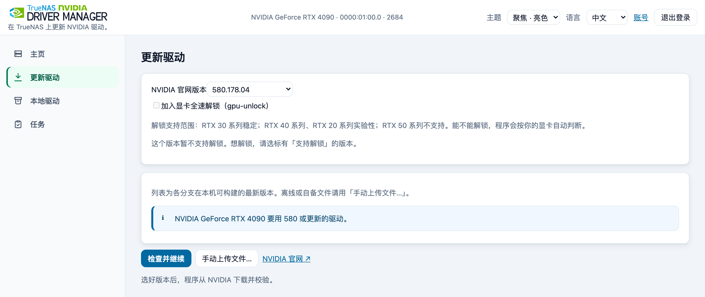
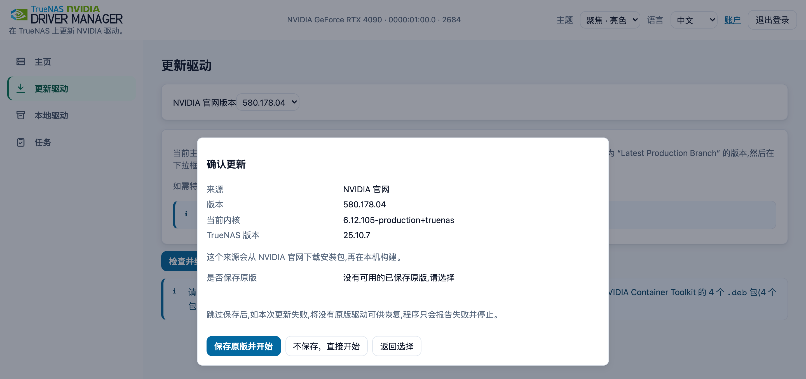
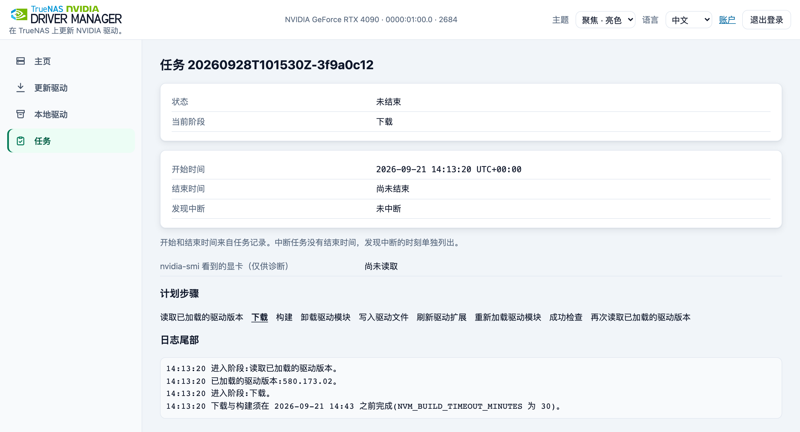
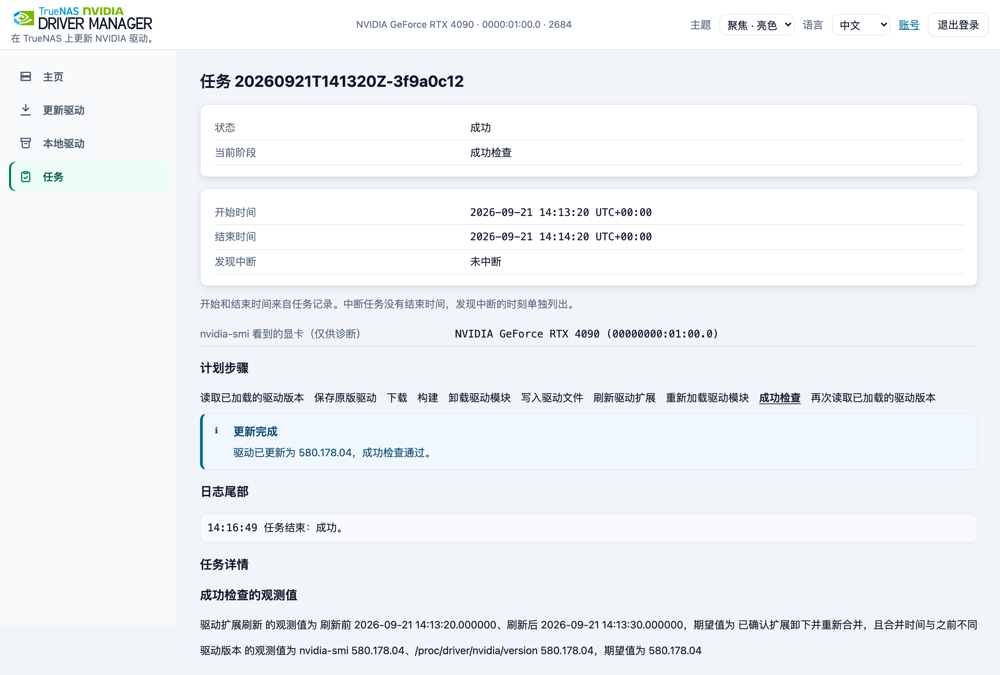
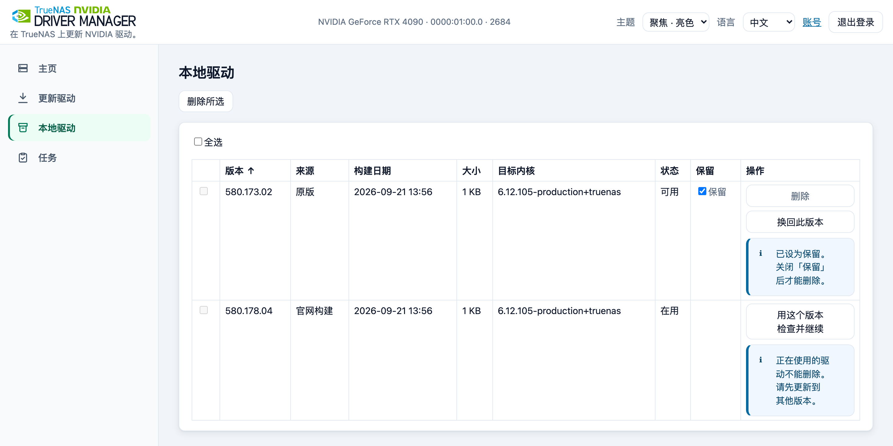

# 运维说明

[English](operations.en.md)

## 更新驱动的详细步骤

简短版本在 [README](../README.zh-CN.md#更新你的驱动)。这里写每一步的细节。

**1. 选择显卡和驱动。**

1. 在左侧菜单里打开更新驱动（窄屏时菜单在页面底部）。有不止一张 NVIDIA 显卡时，勾选将使用这个驱动的显卡。
2. 点开「NVIDIA 官网版本」下拉框，选一个版本。列表里是每个驱动系列在这台机器上能构建的最新版本。要选别的版本，请选最后一项「其他版本…」，再输入版本号。NVIDIA 官网没有的版本，在开始更新前就会被拒绝。
3. 拿不准时，点「NVIDIA 官网 ↗」，找标着「Latest Production Branch」的版本，下拉框里有的话就选它。
4. 点检查并继续。

离线使用，或要用自己的文件时，点手动上传文件…，见[手动上传文件与返回检查](#手动上传文件与返回检查)。驱动可以来自三个地方：NVIDIA 官网列表（由主机下载）、你上传的文件，以及以前保存过的本地驱动（不用下载）。



**2. 检查显卡使用状态。** 检查期间，页面会列出正在使用或正在申请显卡的应用，名单自动刷新。请停止标为「正在使用显卡」的应用，检查随后自动继续。等了大约 30 秒还在使用时，结果窗口会显示名单是什么时候取的。停掉这些应用，再点「重新检查」。程序不会替你停止应用。

**3. 确认更新。** 在确认窗口核对来源、版本和系统。出现「保存原版驱动并开始」时点它；已经保存过原版时，点「开始更新」。



**4. 跟进任务。** 任务页显示当前阶段，实时日志在页面下方。同一时间只运行一个更新，关掉浏览器，任务仍会继续。下载和构建默认共用 30 分钟的时限（`NVM_BUILD_TIMEOUT_MINUTES`）。构建是把驱动做成这台机器的内核能加载的文件。如果在驱动文件被替换之前超时，更新会停止，驱动文件保持不变。



**5. 核验结果。** 任务状态为成功，更新后的检查显示你的新版本，主页显示的版本也一致。



**6. 重启显卡应用。** 请重启驱动变更前已启动的显卡应用。任务页「驱动版本已变更」列出的应用，以及提示「Driver/library version mismatch」的应用都需要重启。

## 为你的显卡选驱动

- **用哪种驱动模块。** 驱动版本为 555 及以上时，程序按你勾选的显卡决定。只要其中有显卡必须用闭源模块（包括 Maxwell、Pascal、Volta），就构建闭源模块，否则构建开源模块。Maxwell、Pascal、Volta 最后能用的驱动系列是 580。这三代显卡在 TrueNAS 27 上还没有实测。
- **较老的显卡。** 列表里有某个版本，不代表它一定适合你的显卡和应用，确认前请先看检查结果和警告。比较老的显卡，只会看到它能用的版本。
- **Kepler 显卡**（包括部分 GTX 600/700 型号）：请选官方 470.256.02。TrueNAS 25.10（内核 6.12）和 TrueNAS 27（内核 6.18）上都提供这个版本。程序会下载 Debian 的社区兼容补丁并套用。补丁的套用和编译，已经在 TrueNAS 25.10.7 和 27.0.0-RC.1 的内核上测过。在真实的 Kepler 显卡上，加载、显示和 CUDA（NVIDIA 用来在显卡上做计算的软件）还没有验证。470 已经停止维护，NVIDIA 不再为它发布安全修复，只建议在没有别的受支持驱动时使用。
- **补丁只用于官方 470.256.02。** 手动上传的 470 安装包不会套用这些补丁。补丁归档要联网下载，不能事先放进 `manager/build-kit/`；构建软件包则可以事先放进去。
- **IBT。** 这套 Debian 补丁会让 470 在内核打开 IBT（间接分支跟踪，CPU 的一项安全功能）时拒绝加载。补丁说明里写的是 Intel 第 11 代以及更新的 CPU。可以在 TrueNAS 的命令行（系统 → 命令行）里运行 `grep '^flags[[:space:]]*:' /proc/cpuinfo | grep -c -w ibt`，数出带有 `ibt` 的行数。结果是 0，只表示这次没有匹配到，不能据此确认 470 能加载。没有匹配时，这条命令的退出码是 1。

## 本地驱动

本地驱动页列出程序构建或保存过的驱动。为当前内核构建的驱动可以直接切换，不用重新下载。为其他内核构建的会显示「内核不匹配」；要用这样的驱动，请在更新驱动页再选一次这个版本（列表里有的话），或重新上传它的安装包，更新时会为当前内核重新构建。为其他内核保存的原版驱动无法使用。带解锁构建的驱动，在「来源」列里显示「· 含全速解锁」。



## 换回已保存的原版驱动

在本地驱动中选择可用的原版行，点「换回此版本」并确认计划。此操作使用已保存的驱动镜像，不下载、不构建。「原版」是为当前内核与 TrueNAS 版本第一次选择保存时，正式路径上的那份驱动文件；程序不判断它是否由 TrueNAS 提供。须有适用于当前内核与 TrueNAS 版本的原版副本，另行下载的 NVIDIA 驱动不能代替该镜像。

自动恢复仅在替换后的驱动检查失败且存在可用原版时进行，并不覆盖每种下载、构建、卸载或写入失败，恢复本身也可能失败。`STOCK_RESTORED` 时已换回原版驱动，本次请求的更新失败。请核对任务检查记录与加载版本，应用是否恢复可用须另外检查。

## TrueNAS 升级之后怎么办

TrueNAS 每次升级，包括从 25.10.7 到 25.10.8 这样的小版本，都会另装一套新系统，叫「引导环境」。原来那套会留着，可以用来回退；只有启动盘空间不够、旧环境又没有设成「保持」时，TrueNAS 才会在升级时自动删掉它。驱动文件是系统的一部分，所以升级会把它换成新版 TrueNAS 自带的那一份，你用本程序换上的驱动留在旧的引导环境里。本程序的账号、任务记录和保存的驱动都在存储池里，也就是安装时为它准备的目录，升级后还在。升级前不需要先换回原版驱动。

**1. 升级后打开主页，核对这几项。**

- 「TrueNAS 版本」是你刚升级到的版本。「当前内核」不一定变，有的升级不换内核。
- 「已加载的驱动版本」一般是新版 TrueNAS 自带的驱动。这个驱动不一定支持你的显卡，例如 TrueNAS 25.10 自带的驱动不支持 Maxwell、Pascal、Volta 显卡，用这些显卡时应用就用不了它。这时按第 2 步装一个支持它的版本。
- 「当前内核与 TrueNAS 版本的原版驱动」显示「未保存」。原版驱动是每种内核和 TrueNAS 版本的组合各存一份，升级后组合变了，要重新存。
- 如果换了内核，本地驱动页里为旧内核构建的驱动会显示「内核不匹配」，不能直接切换。

**2. 决定要不要换驱动。** 新版 TrueNAS 自带哪个驱动，写在它的版本说明里。这个驱动适合你的显卡和应用，就不用做什么。要换的话，先停掉所有用显卡的应用。除了转码的媒体服务器，一直在后台运行 nvidia-smi 的监控程序也会占着显卡；只要还有这类程序在运行，检查就会等约 30 秒，然后提示「无法更新：显卡正被使用」。然后看是哪种情况：

- 内核没变，本地驱动页里有以前为这个内核构建的驱动，它会显示「可用」。选它，点「用这个版本检查并继续」，不用下载，也不用构建。
- 其他情况，按[更新驱动的详细步骤](#更新驱动的详细步骤)再做一次，选以前用的版本或更新的版本。程序会为当前内核重新构建。

确认窗口里出现「保存原版驱动并开始」时，点它，把新版 TrueNAS 自带的驱动存下来，以后可以换回去。任务成功后，看主页上的驱动版本对不对，再把停掉的应用打开；任务页「驱动版本已变更」里列出的应用也要重启。

升级后不需要动 TrueNAS 设置里的 NVIDIA 驱动开关。

**回到旧版 TrueNAS。** 在 TrueNAS 的系统 → 启动里，对旧的引导环境点「启用」，再重启，就回到旧版 TrueNAS 和你在那里装的驱动。系统设置也回到那个引导环境里的样子，升级后改过的设置不会带过去；存储池里的数据和应用不会跟着回到升级前。旧版没有修好的安全问题也会一起回来。TrueNAS 的文档只建议在两种情况下回退：新版本里的存储池升级出了问题，或者配置坏了、又用不了系统控制台。

## 排错与报告问题

先查看首页阻断项、任务状态、错误及检查记录。下载或构建失败可能是 NVIDIA、Docker Hub 或 Debian 快照服务不可达。在 `6.12` 或 `6.18` 内核上使用官方 `470.256.02` 驱动时，主机还会从 snapshot.debian.org 下载社区补丁归档，与构建软件包使用同一来源。修复连通性，或按[部署说明](deploy.zh-CN.md)备齐离线输入，再确认新计划。任务运行中或状态不可读时不要反复提交。

公开 issue 请附程序版本或镜像标签、TrueNAS 与内核版本、显卡型号、所选来源与目标、任务状态和脱敏日志。删除主机地址、本地路径、密码、cookie、令牌及私钥。疑似漏洞按 [SECURITY.md](../SECURITY.md) 私下报告。恢复文件应保留到程序检查允许释放，不要删除任务目录绕过阻断。

版本列表为空或下载失败时，先确认主机能连上 NVIDIA 下载站、Docker Hub 和 Debian 软件包存档。请查防火墙和 DNS（DNS 负责把网站名字换成地址），再看任务日志。列表里有哪些版本，还跟你勾选的显卡有关。

设置码被拒绝、已过期或找不到时：先刷新程序页面，设置码过期后日志里会写入新的。再复制最新一条包含 `SETUP CODE:` 的日志里的设置码，最新的日志在最下面。如果没有这样的日志，在应用 → 已安装里重启应用，等一分钟再看。页面提示稍后再试时，按提示的秒数等待，输错设置码和输错密码共用同一个次数限制。要重置账号，见[忘记密码](#忘记密码重置管理员账号)。

如果以前用过的工具会在开机时换回它自己的驱动，重启后，它可能把本程序装的驱动又换掉。本程序不改那个工具的开机设置，要不要停用它由你决定。

## 手动上传文件与返回检查

在更新驱动页点手动上传文件…。窗口列出 1 个 `.run` 驱动安装包与 4 个同版本 amd64 toolkit `.deb`，各行有官方下载链接。这 4 个包是 NVIDIA 容器工具包（toolkit），让容器里的应用能用显卡；`.deb` 是 Debian 的软件包文件，amd64 表示适用于 64 位 Intel 或 AMD 电脑。toolkit 版本从官方索引读取，无法读取时使用 `1.20.1-1`。只需这 4 个包，不要选 `-dev`、`-dbg` 或校验值文件。顶部驱动版本只生成下载链接，安装版本以文件内容为准。

选择文件后立即上传，先传 `.deb`，最后传 `.run`。查看每行的状态、错误原因与做法，文件未齐时查看底部的已就绪数，齐全后查看完成摘要。程序读取文件时，进度条不显示百分比。上传中点取消上传并确认，会删掉正在传的部分，已收到的文件保留；若需换掉整组文件，点清空重来。没有用上的文件提示可单独移除。

5 个文件都就绪后点检查并继续。窗口在检查期间保持打开，失败时可就地处理；成功后才进入确认。点「返回选择」会回到上传清单，文件仍在。取消计划会释放对暂存文件的锁。开始任务后，本次任务使用的上传文件不能再更换。指纹与校验值在确认页的文件详情里。

程序检查内容、架构与版本，构建时运行安装包自带的完整性检查，不验证 NVIDIA 签名，也不比对官方校验值。检查通过不证明来源可信。离线构建还需备齐[部署说明](deploy.zh-CN.md)中的构建镜像与软件包。

## SSH 密钥登录

在账号页登记 SSH 公钥后，展开登录页的「使用 SSH 密钥登录」，复制一次性挑战，在终端签名后粘回签名即可登录。密码登录入口保留。

- 支持的公钥算法：`ssh-ed25519`、`ecdsa-sha2-nistp256`、`ecdsa-sha2-nistp384`（不收 RSA/sk-*/证书）。最多登记 5 把。
- 页面只提交公钥与签名。公钥、备注或签名框中的私钥内容会在发送前被拦截并清空。
- 登记入口在「账号」页面的「SSH 登录密钥」区；完成设置后即可登记。
- 终端签名命令（把 `<challenge>` 换成页面当前挑战）：

  ```sh
  printf '%s' '<challenge>' | ssh-keygen -Y sign -f ~/.ssh/id_ed25519 -n nvm-login
  ```

  ssh-agent / 1Password 也可以（export 必须单独一行）：

  ```sh
  export SSH_AUTH_SOCK=~/.1password/agent.sock
  printf '%s' '<challenge>' | ssh-keygen -Y sign -f <(ssh-add -L) -n nvm-login
  ```

  agent 里有多把密钥时，`<(ssh-add -L)` 会静默用第一把；此时用账号页每把密钥下方的签名命令，或把 `-f` 指向已登记的公钥文件。1Password 需在其设置里开启 SSH agent。
- 删除一把密钥会立刻作废所有已登录会话（含本浏览器，会自动换新 cookie 继续在线），其他端需重新登录；密码登录不受影响。
- SSH 登录失败、密码登录失败与设置码错误共用同一个限流桶。

## 忘记密码：重置管理员账号

凭证文件在数据目录下：`<数据目录>/manager/secrets/web-credentials.json`。重置步骤如下。

1. 在 TrueNAS 网页里打开主机的命令行（系统 → 命令行），或 SSH 登录主机。这个应用自己的命令行按钮用不了：镜像是空底（`scratch`）镜像，里面没有 shell（见[部署说明](deploy.zh-CN.md)）。
2. 删除凭证文件。这会重置账号并移除全部已登记 SSH 公钥，不会删除驱动或任务：

   ```sh
   rm '<数据目录>/manager/secrets/web-credentials.json'
   ```

3. 不重启应用，刷新程序页面。页面显示设置流程，应用日志会写入新的设置码。在 TrueNAS 打开应用 → 已安装 → 这个应用 → 工作负载，点击容器行的文档图标，提示为查看日志。复制最新一条包含 `SETUP CODE:` 的 JSON 日志里 `msg` 中的完整设置码。
4. 在程序页面输入设置码，设定新密码并重复输入，点击创建管理员。需要的 SSH 公钥须重新登记。

几点说明：

- 删除此文件会移除账号、全部 SSH 公钥及现有会话；任务状态、本地驱动记录与保存的原版文件不受影响。数据目录就是你在 YAML 卷映射里填写的主机目录。登录页显示带数据目录占位的通用凭证文件路径。
- 设置码只能使用一次，满 24 小时或应用重启后失效。过期后重新打开页面或提交设置，日志会写入新设置码；请复制最新一条包含 `SETUP CODE:` 的日志里 `msg` 中的设置码。输错不会替换仍有效的设置码。
- 设置码只出现在应用日志事件 `setup_code_issued` 的 `msg` 中，不进入任务日志或任务状态。应用日志读者及日志收集器能看到仍有效的设置码，分享日志前请移除设置码消息。密码、哈希、挑战、签名、公钥全文与会话令牌不写入日志。
- 设置、密码登录与 SSH 登录共用限流额度；额度耗尽时，正确的设置码或密码也会暂时被拒绝，请等待页面显示的重试时间，不会永久锁定。能够访问端口的攻击者可耗尽额度、延迟登录，请限制为可信管理网络。重启会清空限流额度，并使尚未使用的设置码失效。
- 设置码与密码须经可信连接传输；明文 HTTP 会暴露传输内容。可信管理局域网不足以保障连接时，请配置 TLS 前端。

通过设置流程创建账号后，不支持回退到 0.2.0。若需回到该发行版，请保留升级前备份。

## 备份与还原

- 要备份的是数据目录：凭证文件、任务状态与日志、本地驱动记录（含保存的原版驱动文件）。
- `<数据目录>/manager/build-kit-cache/` 存放核对过的编译软件包（约 88 MiB）。这个目录可以随时删除，下次编译会重新下载这些软件包。
- 做过带解锁的更新后，`<数据目录>/manager/gpu-unlock/firmware/` 存放核对过的解锁固件（约 114 MB）。这个目录可以随时删除，下次带解锁的更新会从安装包重新生成。
- 还原时把整个数据目录放回原位置，再用同一个 compose 起应用。凭证文件决定登录用的账号与密码；
  连着凭证文件一起还原，就不必重建账号。

## 核对已加载的驱动模块

更新或恢复原版后会读取已加载的内核驱动版本。若其他组件抢先加载先前镜像的模块、版本文件缺失，或换成同版本不同文件后完整版本文字未变，任务会进入「核对已加载的驱动模块」（恢复时标题带「恢复原版驱动」）。版本文字无法解析时，直接进入成功检查。

写入镜像之前、核对这一轮卸载之前，以及换回原版卸载之前，程序都会读 `/proc/modules`。显卡被使用时会等：大约每 0.2 秒再读一次，最多约 30 秒，所有 `nvidia*` 模块的引用数都降到等于依赖它的模块数才继续。无法读取时不等待。容器启动、健康检查，以及经 NVIDIA 运行时执行的 `exec`，都会短时间使用显卡。TrueNAS 27 上，`nvidia` 模块装上之后，`nvidia-cdi-refresh` 会使用显卡约 10 秒，这落在等待时间以内。等满仍被使用，更新才停下：不卸载模块，正式路径上的文件保持不变。核对这一轮和换回同样等待。核对这一轮等满仍被使用时，这一轮不卸不装，再交给正常的成功检查。

`rmmod` 因为模块正在使用而失败时，用同样的间隔和大约 30 秒的上限，然后再次执行 `rmmod`。容器健康检查和通过 `nvidia-container-runtime` 执行的 `exec` 大约每 3 秒打开一次空闲显卡，每次大约 2 秒，所以判断使用状态时可能已经空闲，紧接着的 `rmmod` 仍可能被拒绝。程序不会强制卸载（`rmmod -f`），不会停止或屏蔽任何服务，也不会修改 Docker 配置。第一次卸载等满仍被拒绝时，任务失败，已经卸下的模块按相反顺序重新加载，正式路径上的文件保持不变。核对这一轮等满仍被拒绝时，这一轮停下，再交给正常的成功检查。每次等待都会记下等了多久、重试了几次、结果是什么。

重新加载目标是 `nvidia`、`nvidia_drm`、`nvidia_modeset`，再加上任务开始时已经加载的其他驱动模块（例如 `nvidia_uvm`）。被依赖的模块先装。换回和核对这一轮用任务开始时记下的同一组。开始时无法读取模块列表，仍按原来的规则：没有卸载任何模块时，按 `nvidia`、`nvidia_drm`、`nvidia_modeset` 重新加载。

这一阶段按当前模块列表，最多再卸装一轮。核心模块卸不掉时，不装依赖它的模块。任务开始时记下的重新加载目标保持不变；这一阶段不重写镜像、不再次刷新。尝试与版本读数单独记录，不混入第一轮记录。之后仍由正常成功检查决定结果：更新不过且有可用原版时换回一次，换回仍不过则报告恢复检查失败。

## 显卡全速解锁（gpu-unlock）

这是一个可选功能，用来解除 GeForce 显卡对 FP16、BF16、TF32 矩阵运算（累加用 FP32）施加的半速限制。它使用 Zagitta/gpu-unlock 2.0.0 的内核模块（GPL-2.0-only 许可），原样放在 `third_party/gpu-unlock/` 里（见 [THIRD_PARTY_NOTICES.md](../THIRD_PARTY_NOTICES.md)）。速度提升只有在真实显卡上才能测出，本项目没有测过。功能默认关闭。

**怎样开启。** 每次更新单独选择，适用于官网下载和上传的文件：在更新驱动页的版本列表下面勾选「加入显卡全速解锁（gpu-unlock）」（手动上传窗口里有同样的勾选框）。下次开机生效。

- 只有 610.43.03 这个驱动版本支持。
- 支持范围按系列显示（括号里是芯片代号）：RTX 30（GA10x）稳定；RTX 40（AD10x）、RTX 20（TU10x）实验性；RTX 50（GB20x）不支持。更新驱动页和手动上传窗口把它写在勾选框下面的一行里。程序按每块显卡的 PCI 设备 ID（显卡的硬件编号），判断所勾选的显卡里哪些能解锁，用户不用自己对型号。所勾选的显卡都不支持时，勾选框不能勾上。确认窗口里，本次解锁的显卡每涉及一个实验性系列，就提醒一次，例如「RTX 40 系列的解锁仍在试验阶段，可能不稳定。」
- 通过 API 为其他驱动版本、或在没有支持的显卡时要求解锁，会被拒绝，返回 `plan.source_invalid.gpu_unlock_unsupported`（HTTP 422）：「所选显卡或这个驱动版本不支持解锁。」
- 本地驱动行沿用它自己的记录：构建时带着解锁，就一直带着。如果它的某个目标现在不是计入的显卡，确认窗口会说明那块显卡不会被解锁。

**解锁哪些显卡。** 目标是所勾选的显卡中支持解锁的那些，以 PCI 地址写进镜像的规则（`options gpu_unlock targets=…`）；页面显示型号，不显示地址。为虚拟机隔离的显卡不会成为目标。把显卡换到另一个插槽，它的地址会变，不再是目标，主页会显示它没有解锁，需要重新构建。

**镜像里多了什么。** 镜像多出 `usr/lib/modules/<内核>/extra/gpu_unlock.ko`、depmod 生成的模块索引、`usr/lib/modprobe.d/gpu-unlock.conf`（规则 `softdep nvidia pre: vfio-pci gpu_unlock` 和 `options gpu_unlock targets=…` 一行）、`usr/lib/firmware/gpu-unlock/610.43.03/` 下的 16 个固件文件，以及 `usr/share/licenses/gpu-unlock*/` 下的许可文本。16 个固件文件解压后共约 114 MB（113,940,488 字节），但 `nvidia.raw` 增加得少得多：其中两个大文件 `gsp_ga10x.bin` 和 `gsp_tu10x.bin` 与 610.43.03 驱动本来就装在 `usr/lib/firmware/nvidia/610.43.03/` 下的文件相同，镜像里相同的文件只存一份。虚拟机测试中，带解锁构建的 610.43.03 比不带解锁的大 237,568 字节（约 0.24 MB），TrueNAS 25.10.7 和 27.0.0-RC.1 上相同。

**固件从哪来。** 程序不自带固件，而是在主机上、程序进程内，从 NVIDIA 610.43.03 安装包生成。按现在的支持表，带解锁的更新一定安装 610.43.03，所以任务用它自己的安装包（下载的或上传的），不会多下载任何东西。生成的文件要与 17 个固定的 SHA-256 值（16 个固件加 NVIDIA-LICENSE）逐一核对，通过后缓存在 `<数据目录>/manager/gpu-unlock/firmware/610.43.03/`，之后的更新直接复用。如果这个文件给不出固定的那些文件，任务以 `gpu_unlock_installer_unusable`（「这个文件不能用来开启解锁」）失败，驱动保持不变。生成固件这一步也计入 `NVM_BUILD_TIMEOUT_MINUTES`。

**离线主机。** 在能联网的电脑上下载 `NVIDIA-Linux-x86_64-610.43.03-no-compat32.run`，在手动上传窗口把它作为驱动上传，再勾选解锁，不会下载任何东西。其他离线材料与普通上传相同，见[部署说明](deploy.zh-CN.md)。

**任务阶段。** 带解锁的更新多两个阶段：

- 「生成解锁文件」在构建之前。本地驱动行不需要构建，所以没有这一阶段。
- 「试着装上解锁组件（不解锁任何显卡）」在构建之后、替换驱动文件之前；本地驱动行则在卸载模块之前。它用 `insmod` 不带目标地装一次，不会解锁任何显卡。内核拒绝该模块时，任务以 `gpu_unlock_module_rejected`（「这台电脑拒绝装上解锁组件」）结束，驱动保持不变。模块已经装着时，跳过试装。

其他解锁失败也都发生在替换驱动文件之前：`gpu_unlock_firmware_failed`（「没能准备好解锁文件」）、`gpu_unlock_module_build_failed`（「解锁组件制作失败」）、`gpu_unlock_install_failed`（「没能把解锁组件、解锁设置和解锁文件装进驱动」）。如果任务在试装之后停止，系统里可能还留着一个什么都不做的解锁组件。下次开机会消失。

**成功检查。** 镜像带这条规则的更新，更新后的检查多一项「虚拟机显卡保护（vfio-pci 把显卡留给虚拟机，要先于驱动启动）」：vfio-pci 必须先于 gpu_unlock 和 nvidia 加载，否则检查不通过，任务自动换回已保存的原版（`STOCK_RESTORED`）。gpu_unlock 是否先于 nvidia 加载只作记录。如果不是，成功页会写：「显卡全速解锁的解锁设置在这台电脑上没有生效。下次开机不会解锁。驱动仍可照常使用。」否则写：「显卡全速解锁已装好，下次开机生效。」

**主页读数。** 当前合并的镜像带这条规则时，主页显示「显卡全速解锁」，每个目标显卡一行。这个读数只读，不会触发任何操作。

- 「<型号> 已解锁」。
- 「<型号> 需要断电后重新开机。请先关机，切断电源，再开机。」。
- 「<型号>：解锁已装好，下次开机生效」。
- 「<型号> 没有解锁。系统日志原文：<内核日志一行>」；没有日志行时写「<型号> 没有解锁。这次开机时，解锁没有运行。」。

本次开机后重新加载过驱动时，另有一行说明：「这次开机之后，驱动又加载过一次。解锁状态要以下次开机为准。」在 TrueNAS 界面里点重启，不一定会让显卡断电，所以显卡可能报告「需要断电后重新开机」。请先关机，断开电源，再重新开机。

**被隔离的显卡。** 镜像里的规则让 vfio-pci 保持在最前面，为虚拟机隔离的显卡仍由 vfio-pci 占用。

**怎样去掉解锁。** 更新到任何不带解锁的驱动即可：不勾选解锁的官网版本、构建时没带解锁的本地驱动行，或已保存的原版。带解锁构建的本地驱动行，在「来源」列里显示「· 含全速解锁」。

**限制。**

- 在 TrueNAS 设置里把 NVIDIA 驱动开关关掉再打开，去不掉解锁。TrueNAS 会删掉再重建链接 `/run/extensions/nvidia.raw`，并重启 Docker，但正式路径上的文件不变。要去掉解锁，请更新到不带解锁的驱动（见上文「怎样去掉解锁」）。
- 这个模块和程序的 `nvidia.ko` 一样没有签名。系统强制检查模块签名时，两者都装不上。

## 中断的任务

替换在主机 systemd 单元中执行，可以跨应用容器重启继续运行。主机重启、断电或 runner 未写终态就退出时，状态核对可能将任务记为 `INTERRUPTED`。首页顶部的提示按停下的步骤说明后果，任务页的「任务详情」给出停在的步骤与任务号。

- 停在读取版本、保存原版、下载或构建：正式路径上的驱动文件没有被替换，主机上的驱动没有变化。重新选择版本再更新即可。
- 停在卸载驱动模块：驱动文件没有被替换，但驱动模块可能已经卸载。
- 停在写入、刷新、重新加载，以及恢复原版时对应的卸载、写入、刷新、重新加载：驱动文件是否已经替换无法判断，驱动模块可能已卸载且没有重新加载。
- 停在任一核对已加载的驱动模块阶段：文件已经写入，驱动模块可能已卸载且没有重新加载。对账会保留阶段与独立尝试记录，不自动续跑，也不自动开始新任务。
- 带解锁的更新停在试装之后：系统里可能还留着一个什么都不做的解锁组件。下次开机会消失，首页会写明。它不会解锁任何显卡。
- 处置办法：先看首页显示的当前驱动版本与任务详情里的检查记录，确认主机现在的状态；再重新选择版本更新一次。若驱动模块没有重新加载、应用用不了显卡，先核对当前镜像、安排维护窗口，再考虑重启主机，让系统重新合并当前 sysext 镜像并加载模块；这不能保证损坏或不适用的镜像恢复正常。
- 未了结的任务会保留目录与输入，直到更晚创建的任务完成经过核验的替换或恢复。空闲时刷新页面会自动检查：后续任务的驱动库镜像与正式路径镜像仍然一致、目标模块已经加载、内核与 nvidia-smi 的版本均与目标一致，且主机的可写挂载与只读属性已经复位，才会释放目录。主机重启或 sysext 重新合并后，这些读数仍一致即可释放。任何保留任务仍有主机残留，都会阻止所有任务释放，也会拒绝新的更新。
- 终态任务的目录仍保留时，任务页提供「释放恢复材料」按钮。确认后立即执行相同检查，不满足时说明拒绝原因，不能强制释放。状态文件与日志保留作历史，记录释放时间及提供证明的后续任务号。释放已记录但目录删除失败时，下次空闲刷新会重试。
- 本地驱动库里的 `<id>-build` 镜像是另一块空间。释放任务输入不会删除该镜像；不再需要时，可在本地驱动表里单独删除。

显卡被使用时，点「检查并继续」约 1 秒后按钮旁出现固定高度占位，取得名单后每约 2 秒静默刷新；任务页等待说明下也显示。停止标为「正在使用显卡」的应用后，等待会自动继续；等满仍被使用时，最终提示保留同样的标注和名单时间，可点「重新检查」重试同一次更新。更新按钮旁可「取消等待」，只取消浏览器本次检查；服务端这次检查仍会自然结束，立即重试可能需要排队。任务中不提供取消。名单用 ●、?、○ 配合文字标记，消失的应用显示 ✓ 已停止约 4 秒后移除，减少动态效果时直接移除。程序不会替用户停止应用。

显卡使用者列表包含 Docker 应用与 Incus 实例。程序先调用 `container.query`（含设备列表），只有主机明确回答接口不存在时才改用 `virt.instance.*`；两者都不存在时，实例列表为空。「正在使用显卡」表示名单内该容器自己的进程此刻打开了 `/dev/nvidia*` 或驱动为 NVIDIA 的 `/dev/dri` 设备；「仅申请」表示已配置显卡但没有打开设备。只读取这些进程的 fd 符号链接目标，不扫描名单外进程，不读进程名、命令行或环境。任一步无法读取就标「无法判断」；实例接口未提供可靠成员进程时也用此标注。名单按正在使用、无法判断、仅申请排序。任务页还显示每次替换后检查时，只读 `nvidia-smi` 查询看到的显卡名称与 PCI 地址，无法读取时显示原因。这一行仅供诊断，不参与成败判定，也不触发恢复；如果执行了恢复检查，它显示的是最后一次检查的结果。


## 日志

- 任务日志在数据目录的 `manager/state/<任务id>.log`，任务页显示它的尾部。
- `docker logs` 里程序自己写的行是英文，每行一个 JSON 对象，可以直接用 `docker logs <容器名>` 查看。
- `task_cleanup` （`task cleanup finished`） 只在任务目录被删除时记一次。保留目录或重复清理已经删除的目录时不记完成日志。`host_reset` 记录观察到的主机实际改动，带 `task_id` 和 `step`： `delete_temp_file`、`unmount_writable_mount` 或 `restore_readonly`。主机未变化时不记复位日志；失败仍逐步记 `task_cleanup_step_failed`，带步骤和原因。
